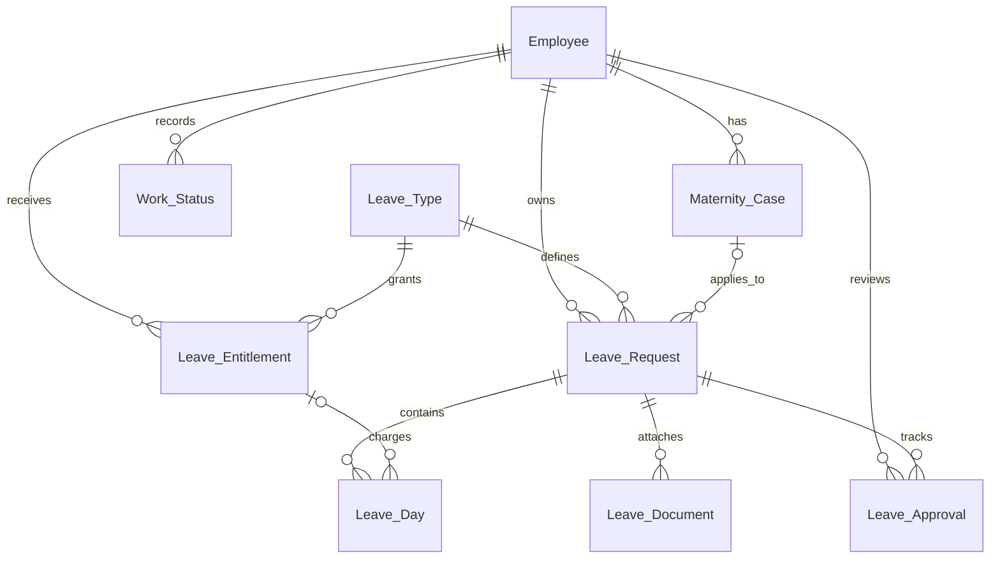

# คำอธิบายโค้ด Leave Management

สคริปต์สำหรับอธิบายโปรเจกต์ พร้อมลำดับเปิดไฟล์ประกอบ ครอบคลุม Frontend, Backend, API, ฐานข้อมูล กฎการลา และเครื่องมือพัฒนา อ้างอิงโค้ดที่ตรวจวันที่ **13 ตุลาคม 2569**

ข้อความในกรอบคำพูดใช้เป็นบทพูดได้ ส่วนตารางและตัวอย่างโค้ดใช้ประกอบการอธิบาย ไม่จำเป็นต้องอ่านชื่อทุกไฟล์หรือทุกพารามิเตอร์ออกเสียง

## สารบัญ

1. [เกริ่นนำและภาพรวม](#1-เกริ่นนำและภาพรวม)
2. [เทคโนโลยีและโครงสร้าง](#2-เทคโนโลยีและโครงสร้าง)
3. [ผู้ใช้งานและสิทธิ์](#3-ผู้ใช้งานและสิทธิ์)
4. [Frontend: จุดเริ่มต้นและ React](#4-frontend-จุดเริ่มต้นและ-react)
5. [Frontend: หน้าจอและองค์ประกอบร่วม](#5-frontend-หน้าจอและองค์ประกอบร่วม)
6. [Frontend: การเชื่อมข้อมูล](#6-frontend-การเชื่อมข้อมูล)
7. [Backend: Go และการแบ่งหน้าที่](#7-backend-go-และการแบ่งหน้าที่)
8. [API: เส้นทางและข้อมูลที่รับส่ง](#8-api-เส้นทางและข้อมูลที่รับส่ง)
9. [Database: ตารางและความสัมพันธ์](#9-database-ตารางและความสัมพันธ์)
10. [ติดตามการทำงานตั้งแต่ต้นจนจบ](#10-ติดตามการทำงานตั้งแต่ต้นจนจบ)
11. [กฎการลา วันที่ และเอกสาร](#11-กฎการลา-วันที่-และเอกสาร)
12. [การแจ้งเตือนและประวัติพนักงาน](#12-การแจ้งเตือนและประวัติพนักงาน)
13. [การทดสอบและเครื่องมือ](#13-การทดสอบและเครื่องมือ)
14. [การเปิดระบบและการนำขึ้น Vercel](#14-การเปิดระบบและการนำขึ้น-vercel)
15. [ลำดับสาธิตและคำถามที่อาจได้รับ](#15-ลำดับสาธิตและคำถามที่อาจได้รับ)
16. [ข้อจำกัดปัจจุบันและบทปิด](#16-ข้อจำกัดปัจจุบันและบทปิด)

## 1. เกริ่นนำและภาพรวม

**บทพูด**

> โปรเจกต์นี้ชื่อ Leave Management เป็นระบบจัดการการลาของพนักงานครับ พนักงานสามารถยื่นคำขอ ตรวจสอบสิทธิ์วันลา และติดตามผลได้ ผู้จัดการใช้พิจารณาคำขอของทีม ส่วนฝ่ายบุคคลใช้จัดสรรสิทธิ์ ตั้งนโยบาย และให้ความเห็นเมื่อผู้จัดการส่งคำขอมาให้ปรึกษา
>
> ระบบแบ่งงานเป็นส่วนหน้าเว็บ ส่วนหลังบ้าน API และฐานข้อมูล หน้าเว็บรับข้อมูลจากผู้ใช้ API เป็นช่องทางติดต่อกับหลังบ้าน หลังบ้านตรวจสิทธิ์และเงื่อนไขก่อนให้ repository บันทึกข้อมูล แล้วส่งผลกลับมาให้หน้าเว็บแสดง

ลำดับหลักของโหมด API:

```text
ผู้ใช้กดปุ่มบนหน้า React
        ↓
ApiRepository ส่ง HTTP และ JSON
        ↓
Go + Gin รับคำขอและตรวจ session
        ↓
Service ตรวจสิทธิ์และกฎการลา
        ↓
Repository บันทึก JSON หรือ PostgreSQL
        ↓
API ส่งผลกลับ → React โหลดข้อมูลใหม่และแสดงผล
```

โหมดเบราว์เซอร์มีลำดับต่างออกไป: React → BrowserRepository → JavaScript domain → IndexedDB โดยไม่ได้เรียก Go API การสาธิตควรบอกก่อนว่ากำลังเปิดโหมดใด

## 2. เทคโนโลยีและโครงสร้าง

**บทพูด**

> ส่วนหน้าเว็บใช้ React กับ JavaScript และ JSX มี Vite ช่วยเปิดระบบระหว่างพัฒนาและสร้างไฟล์เว็บ ใช้ React Router เปลี่ยนหน้า ส่วนรูปแบบหน้าจอใช้ Tailwind ร่วมกับ CSS ของโปรเจกต์
>
> หลังบ้านหลักใช้ Go กับ Gin และใช้ pgx เมื่อติดต่อ PostgreSQL บน Supabase ส่วน Node ที่อยู่ในโฟลเดอร์ server เป็นหลังบ้านเดิมที่เก็บไว้สำหรับโหมด legacy และทดสอบเทียบพฤติกรรมครับ

| ส่วน | เครื่องมือ | หน้าที่ |
| --- | --- | --- |
| Frontend | React, JavaScript, JSX | สร้างหน้าจอและจัดการการโต้ตอบ |
| Routing | React Router, HashRouter | เปลี่ยนหน้าด้วย URL เช่น `#/requests` |
| Build | Vite | เปิด dev server และสร้างเว็บใน `dist/` |
| รูปแบบหน้าจอ | Tailwind CSS, `src/styles.css` | จัด layout สี ธีม และหน้าจอขนาดต่าง ๆ |
| ไอคอนและฟอนต์ | Lucide React, IBM Plex Sans Thai | ไอคอนและตัวอักษรไทย |
| Backend หลัก | Go, Gin | รับ HTTP ตรวจ session และเรียกกฎการลา |
| ฐานกลาง | PostgreSQL บน Supabase, pgx | บันทึกข้อมูลที่หลายเครื่องใช้งานร่วมกัน |
| โหมดทดลอง | IndexedDB หรือไฟล์ JSON | ทดลองระบบโดยไม่ต้องใช้ฐานกลาง |
| ทดสอบ | Node test runner, Jest, React Testing Library, Go testing | ตรวจ domain, หน้าจอ, repository และ API |
| คำอธิบายชนิดข้อมูล | JSDoc, `jsconfig.json` | ช่วย editor และตรวจสัญญาข้อมูล |

โค้ดที่โปรเจกต์เขียนเองในส่วน JavaScript ใช้ `.js`, `.jsx`, `.mjs` หรือ `.cjs` ไม่ได้ใช้ไฟล์ TypeScript แล้ว แต่ยังมีแพ็กเกจ `typescript` และ `@types/*` เป็นเครื่องมือตรวจ JSDoc และแนะนำชนิดข้อมูล ไม่ใช่ขั้นตอนแปลง source TypeScript ของแอป

| โฟลเดอร์ | สิ่งที่อยู่ภายใน |
| --- | --- |
| `src/` | หน้า React, domain ฝั่ง JavaScript และตัวเชื่อมข้อมูล |
| `internal/httpapi/` | Go handler และเส้นทาง API |
| `internal/service/` | กฎการลาและการตรวจสิทธิ์ |
| `internal/repository/` | การอ่านเขียน JSON และ PostgreSQL |
| `internal/model/` | Go structs และชื่อฟิลด์ JSON |
| `cmd/server/` | จุดเริ่ม Go server สำหรับเครื่องพัฒนา |
| `api/`, `serverless/` | จุดรับคำขอบน Vercel |
| `server/` | Node legacy และตำแหน่งไฟล์ข้อมูล runtime ในเครื่อง |
| `database/` | SQL schema, migrations และไฟล์ส่งออก |
| `scripts/` | สคริปต์เปิดระบบ สร้างข้อมูล และตรวจความตรงกัน |
| `tests/` | ชุดทดสอบ JavaScript และ React |
| `public/` | ฟอนต์ ใบอนุญาต ไอคอน และภาพ SVG |
| `docs/` | เอกสารอธิบาย frontend, backend, API และฐานข้อมูล |

## 3. ผู้ใช้งานและสิทธิ์

**บทพูด**

> ระบบมีสามบทบาทครับ คือพนักงาน ผู้จัดการ และฝ่ายบุคคล บทบาทถูกอ่านจากบัญชีที่ระบบยืนยันแล้ว การเลือกหมวดผู้จัดการบนหน้าเข้าสู่ระบบเป็นเพียงการกรองบัญชีทดลอง ไม่ได้ทำให้บัญชีพนักงานมีสิทธิ์ผู้จัดการ
>
> การซ่อนเมนูช่วยให้ผู้ใช้เห็นเฉพาะงานที่เกี่ยวข้อง แต่ยังต้องตรวจสิทธิ์ที่หลังบ้าน เพราะผู้ใช้สามารถเรียก URL หรือส่ง HTTP เองได้

| งาน | พนักงาน | ผู้จัดการ | HR |
| --- | --- | --- | --- |
| ยื่นคำขอลาของตนเองผ่านฟอร์มปัจจุบัน | ได้ | ยังไม่ได้เปิดให้บทบาทนี้ | ยังไม่ได้เปิดให้บทบาทนี้ |
| แก้ไขหรือยกเลิกคำขอที่ยังรอพิจารณา | เจ้าของคำขอ | ไม่ใช้แก้คำขอแทนผู้อื่น | ไม่ใช้แก้คำขอแทนผู้อื่น |
| อนุมัติหรือไม่อนุมัติ | ไม่ได้ | คำขอของทีมที่ตนรับผิดชอบ | ไม่ใช่ผู้ตัดสินแทนผู้จัดการ |
| ส่งปรึกษา HR | ไม่ได้ | ได้สำหรับคำขอของทีม | ให้ความเห็นในคำขอที่ได้รับมอบหมาย |
| จัดสรรสิทธิ์และเปิดกรณีลาคลอด | ไม่ได้ | ไม่ได้ | ได้ |
| ตั้งนโยบายและวันหยุด | ไม่ได้ | ไม่ได้ | ได้ |
| ดูสถานะพื้นฐานของเพื่อนร่วมงาน active | ได้ทุกคน | ได้ทุกคน | ได้ทุกคน |
| ดูประวัติส่วนตัว | ตนเอง | พนักงาน active ข้ามฝ่าย | ข้ามฝ่าย รวมบัญชี inactive |

สิทธิ์ดูประวัติพนักงานแยกจากสิทธิ์ดูคำขอและเอกสาร ผู้จัดการที่เปิดโปรไฟล์ข้ามฝ่ายได้ ไม่ได้มีสิทธิ์อนุมัติคำขอข้ามทีมตามไปด้วย

## 4. Frontend: จุดเริ่มต้นและ React

### 4.1 เริ่มจาก `src/main.jsx`

**บทพูด**

> ไฟล์ main เป็นจุดเริ่มหน้า React ครับ โดยหา element ที่ชื่อ root จากหน้า HTML แล้วใช้ createRoot วาด App ลงไป ไฟล์นี้ยังโหลด Tailwind และ CSS หลักด้วย ส่วน StrictMode ใช้ช่วยตรวจพฤติกรรมระหว่างพัฒนา

โค้ดส่วนสำคัญ:

```jsx
createRoot(document.getElementById('root')).render(
  <React.StrictMode>
    <App />
  </React.StrictMode>,
);
```

`index.html` เป็นหน้าเริ่มของ Vite ส่วน `src/main.jsx` เป็นจุดเริ่มของ React

### 4.2 `src/App.jsx` ดูแลสถานะรวม

**บทพูด**

> App ดูแลว่าขณะนี้ใครเข้าสู่ระบบอยู่ มีข้อมูลพร้อมหรือยัง และต้องแสดงหน้าเข้าสู่ระบบหรือพื้นที่ทำงาน ตัวแปร actor คือบัญชีปัจจุบัน ส่วน db คือ snapshot ที่กรองตามสิทธิ์แล้ว ไม่ใช่ข้อมูลทั้งหมดของฐานกลาง
>
> เมื่อหน้าใดต้องทำรายการ จะเรียก run ซึ่งส่งคำสั่งผ่าน repository แล้วโหลด snapshot ใหม่ ถ้าการทำรายการล้มเหลว จะส่งข้อผิดพลาดกลับไปให้หน้าฟอร์มแสดง

| ตัวแปรหรือฟังก์ชัน | ความหมาย |
| --- | --- |
| `actor` | บัญชีที่ยืนยันแล้ว มี id, role และข้อมูลพนักงาน |
| `db` | ข้อมูลที่บัญชีนี้มีสิทธิ์ใช้ใน workspace |
| `loading`, `error` | สถานะโหลดและข้อความผิดพลาด |
| `theme` | ธีมสว่างหรือมืด |
| `mobile`, `commandOpen`, `profile` | การเปิด drawer, ค้นหาด่วน และป๊อปอัปประวัติ |
| `entry` | ช่วงตรวจสอบ ยืนยัน และเปลี่ยนหน้าของ login/logout |
| `sessionVersion` | กันข้อมูลจาก session เก่ามาทับหลังเริ่มออกจากระบบ |
| `login()` | รอยืนยันบัญชีและโหลด snapshot ก่อนเปิด workspace |
| `logout()` | รอออกจากระบบสำเร็จแล้วจึงล้างบัญชีและข้อมูลบนหน้าจอ |
| `reload()` | ขอ snapshot ล่าสุดและตรวจว่ายังเป็น session เดิม |
| `run()` | ส่ง command โหลดข้อมูลใหม่ และแสดงผลการทำรายการ |

React hooks ที่พบในโค้ด:

| Hook | ตัวอย่างหน้าที่ในแอป |
| --- | --- |
| `useState` | เก็บค่าฟอร์ม บัญชี ธีม และสถานะเปิดปิดกล่อง |
| `useEffect` | โหลดข้อมูล ตั้ง timer ฟัง event และคืนทรัพยากรเมื่อออกจากหน้า |
| `useRef` | เก็บตัวกันกดซ้ำ ตัวควบคุมงาน และ element ที่จะคืนโฟกัส |
| `useCallback` | เก็บฟังก์ชันร่วม เช่น reload ให้เหมาะกับ dependencies |
| Context | ส่งวิธีเปิดป๊อปอัปประวัติไปยังลิงก์ชื่อพนักงาน |

### 4.3 Login และ Logout

เปิด `src/Login.jsx`, `src/EntryTransition.jsx` และ `src/motion.js`

**บทพูด**

> หน้าเข้าสู่ระบบให้เลือกบทบาทเพื่อเปิดรายการบัญชีทดลอง หรือพิมพ์ชื่อผู้ใช้กับอีเมลเองได้ ช่องข้อมูลเริ่มว่าง เมื่อเลือกบุคคลจากรายการจึงเติมชื่อผู้ใช้และรหัสทดลอง การยืนยันตัวตนจริงของแอปยังตรวจบัญชีผ่าน repository
>
> ตอนเข้าสู่ระบบจะรอทั้งผล login และข้อมูล workspace ก่อนแสดงว่าพร้อม ตอนออกจากระบบก็ต้องรอให้ repository ออกจากระบบสำเร็จก่อน ถ้าล้มเหลวจะกลับพื้นที่ทำงานและแสดงข้อผิดพลาดครับ

`motion.js` กำหนดช่วง `checking`, `ready`, `leaving` และการรอที่ยกเลิกได้ เมื่อเครื่องตั้ง Reduce Motion จะลดหรือข้ามเวลารอด้านภาพ แต่ยังรอการทำงานจริง ไม่ข้ามการตรวจบัญชี

### 4.4 เปลี่ยนหน้าด้วย `src/routes.jsx`

**บทพูด**

> ระบบใช้ HashRouter ครับ เช่นประวัติคำขอเป็นเครื่องหมายชาร์ปตามด้วย requests ส่วนหลังเครื่องหมายชาร์ปใช้เลือกหน้าบน React การเข้าหน้าโดยตรงหรือกดย้อนกลับจึงยังทำงานได้

| URL ตัวอย่าง | หน้าจอ | ขอบเขต |
| --- | --- | --- |
| `#/dashboard` | หน้าหลัก | ทุกบทบาท |
| `#/new` | ยื่นคำขอลา | Employee |
| `#/requests` | ประวัติของตนเอง / คำขอทีม / คำขอปรึกษา HR | ตามบทบาท |
| `#/request/1001` | รายละเอียดคำขอ | ต้องมีสิทธิ์ในคำขอนั้น |
| `#/request/1001/edit` | แก้ไขคำขอ | Employee เจ้าของคำขอที่รอพิจารณา |
| `#/quota` | สิทธิ์และโควตา | Employee |
| `#/work` | สถานะการทำงาน | ทุกบทบาท |
| `#/colleagues` | สถานะเพื่อนร่วมงาน | ทุกบทบาท |
| `#/employee/1` | ประวัติพนักงานเต็มหน้า | ตรวจสิทธิ์โปรไฟล์อีกครั้ง |
| `#/calendar` | ปฏิทินการลา | Manager และ HR |
| `#/notifications` | รายการแจ้งเตือนเต็มหน้า | แจ้งเตือนของบัญชีตนเอง |
| `#/admin` | ข้อมูลและสิทธิ์การลา | HR |
| `#/settings` | การตั้งค่า | HR |

`createWorkspaceRoutes()` สร้างรายการเส้นทางตาม actor ส่วน `RequestRoute` และ `EmployeeProfileRoute` ตรวจรูปแบบ id ก่อนเปิดหน้า หากเส้นทางไม่ถูกต้องจะแสดงหน้าสำหรับไม่พบหน้าหรือไม่มีสิทธิ์

## 5. Frontend: หน้าจอและองค์ประกอบร่วม

### 5.1 หน้าจอแต่ละงาน

**บทพูด**

> หน้าจอแยกไฟล์ตามงานเพื่อให้หาโค้ดง่ายครับ เช่นฟอร์มยื่นลาอยู่ LeaveForm รายละเอียดคำขออยู่ RequestDetail และการจัดสรรสิทธิ์อยู่ AdminPage ส่วน pages.jsx เป็นไฟล์รวม exports ไม่ใช่หน้าจออีกชุด

| ไฟล์ | สิ่งที่ควรอธิบายเมื่อเปิดไฟล์ |
| --- | --- |
| `src/Dashboard.jsx` | เลือกข้อมูลภาพรวมและองค์ประกอบตามบทบาท |
| `src/pages/LeaveForm.jsx` | เก็บค่าฟอร์ม แปลงวันที่ ตรวจ preview อ่านเอกสาร และแบ่งกรอก/ตรวจสอบ/ส่งสำเร็จ |
| `src/pages/Requests.jsx` | ค้นหาและกรองรายการตามสถานะ ประเภท และช่วงวันที่ |
| `src/pages/requestScope.js` | ฟังก์ชัน `assigned()` เลือกคำขอตนเอง ทีม หรือรายการปรึกษาที่มอบหมายให้ HR |
| `src/pages/RequestDetail.jsx` | รายละเอียด timeline เอกสาร และปุ่มพิจารณาตามสิทธิ์ |
| `src/pages/Quotas.jsx` | แสดง total, used, remaining, pending และสิทธิ์รายกรณี |
| `src/pages/WorkPage.jsx` | บันทึกสำนักงาน ทำงานจากบ้าน หรือปฏิบัติงานนอกสถานที่ |
| `src/pages/CalendarPage.jsx` | แสดงวันลาในปฏิทินจากข้อมูลที่มีสิทธิ์เห็น |
| `src/ColleaguesPage.jsx` | โหลดพนักงาน active ทุกคน ค้นชื่อ/รหัสและวันที่ แสดงสถานะพื้นฐาน |
| `src/pages/NotificationsPage.jsx` | รายการแจ้งเตือนของบัญชีและการอ่านทั้งหมด |
| `src/pages/AdminPage.jsx` | HR จัดสรรสิทธิ์รายปีและเปิดกรณีลาคลอด |
| `src/pages/SettingsPage.jsx` | นโยบาย วันหยุด ส่งออก snapshot และคืนค่าข้อมูลจำลอง |
| `src/pages/EmployeeProfilePage.jsx` | โหลดประวัติแยก แสดงแบบเต็มหน้าหรือ embedded ในป๊อปอัป |
| `src/pages/useTask.js` | แบ่งสถานะ busy/error และเรียกคำสั่งร่วมของหน้าจอ |
| `src/pages/types.js` | JSDoc ของ `PageProps`: db, actor, run และ reload |

หน้าเพื่อนร่วมงานแยกค่าที่กำลังกรอกออกจากตัวกรองที่ส่งแล้ว การแก้ช่องค้นหาอย่างเดียวไม่เปลี่ยนรายการจนกดค้นหา และรีเฟรชด้วยตัวกรองที่ส่งล่าสุด

### 5.2 Component ที่ใช้ร่วมกัน

| ไฟล์ | หน้าที่ |
| --- | --- |
| `src/components.jsx` | Card, Heading, Badge, Empty, KeyRow, Stat, DateField, RequestTable, DocumentRow และ Dialog |
| `src/ui.jsx` | BrandMark, Avatar, Stepper, ส่วนภาพรวม Dashboard และ CommandMenu |
| `src/Navigation.jsx` | เมนูด้านซ้ายและ drawer มือถือ |
| `src/AccountMenu.jsx` | รูปบัญชีมุมขวาบนและตัวเลือกโปรไฟล์ |
| `src/EmployeeProfileLink.jsx` | ตรวจสิทธิ์แสดงลิงก์ชื่อและใช้ Context เปิดป๊อปอัป |
| `src/EmployeeLabel.jsx` | แสดงฝ่าย/ตำแหน่งด้วย label กลาง |
| `src/NotificationPopover.jsx` | กล่องจากกระดิ่ง ตัวกรองทั้งหมด/ยังไม่อ่าน และอ่านทั้งหมด |
| `src/NotificationToasts.jsx` | คิวแจ้งเตือนใหม่มุมขวาล่างและ timer 3 วินาที |
| `src/ThemeButton.jsx` | ปุ่มเปลี่ยนธีม |
| `src/EntryTransition.jsx` | หน้าระหว่างเข้าสู่ระบบและออกจากระบบ |

**บทพูด**

> Component ที่ใช้ซ้ำช่วยให้แต่ละหน้ามีรูปแบบเดียวกันครับ อย่าง Dialog ไม่ได้ทำแค่แสดงกล่อง แต่ดูแลโฟกัส การกด Esc และป้องกันการคลิกพื้นหลังด้วย ส่วน DateField รับวันที่แบบไทยและใช้ helper ตรวจวันที่ก่อนนำไปใช้

### 5.3 สี ธีม ภาษา และไฟล์ภาพ

`src/tailwind.css` มี theme/utilities สำหรับ layout และไม่โหลด Preflight ส่วน `src/styles.css` กำหนดสี ฟอนต์ ธีม responsive และ animation ผ่าน CSS tokens จึงเปลี่ยนธีมได้โดยไม่แก้สีทีละหน้า

`src/labels.js` แปลค่าที่เก็บไว้เพื่อแสดงบนหน้าจอ เช่น `Pending` → “รอพิจารณา” แต่ค่า API และฐานยังเป็น `Pending` การแสดงตำแหน่งอังกฤษแปลเฉพาะค่าชุดทดลองที่รู้จัก ไม่เขียนทับข้อมูลที่ผู้ใช้กำหนดเอง

ฟอนต์อยู่ใน `public/fonts/` พร้อม `OFL.txt` ภาพประกอบอยู่ใน `public/art/leave-garden.svg` และไอคอนเว็บไซต์อยู่ใน `public/favicon.svg`

## 6. Frontend: การเชื่อมข้อมูล

### 6.1 Repository เป็นตัวกลาง

เปิด `src/domain/types.js` และ `src/data/index.js`

**บทพูด**

> หน้า React เรียก repository แทนการรู้ว่าข้อมูลอยู่ไฟล์ไหนหรือตารางไหนครับ ทั้งตัวที่ใช้ IndexedDB และตัวที่เรียก API มีชื่อเมธอดร่วมกัน เช่น login, snapshot และ execute การเลือกแหล่งข้อมูลจึงอยู่ที่ data/index.js

```js
export const dataMode = import.meta.env?.VITE_DATA_MODE === 'api' ? 'api' : 'mock';
export const repository = dataMode === 'api' ? new ApiRepository() : new BrowserRepository();
```

| เมธอดของ `LeaveRepository` | สิ่งที่ทำ |
| --- | --- |
| `login(identifier, password)` | ตรวจบัญชีและคืน Employee |
| `session()` | คืนบัญชีที่ยังอยู่ใน session หรือ null เมื่อไม่ได้เข้าสู่ระบบ |
| `logout()` | ออกจากระบบ |
| `snapshot()` | อ่านข้อมูลตามสิทธิ์ |
| `getEmployeeProfile(employeeId)` | อ่านประวัติแยกจาก snapshot |
| `searchColleagues(query, date)` | ค้นสถานะพื้นฐานของเพื่อนร่วมงาน |
| `execute(command)` | ส่งคำสั่งที่เปลี่ยนข้อมูล |
| `downloadDocument(document)` | API adapter ดาวน์โหลดเอกสาร remote; เมธอดนี้เป็น optional ในสัญญา |
| `resetDemo()` | คืนชุดข้อมูลจำลองตามสิทธิ์ |

### 6.2 BrowserRepository

**บทพูด**

> โหมดเบราว์เซอร์เก็บข้อมูลใน IndexedDB และใช้ sessionStorage เก็บ id ของบัญชีในแท็บ เป็น session จำลองครับ เวลาเปลี่ยนข้อมูลจะเรียก JavaScript domain แล้วเขียนลง IndexedDB ใน transaction เดียว ส่วน BroadcastChannel ใช้บอกแท็บอื่นให้โหลดข้อมูลใหม่

ไฟล์ `src/data/browserRepository.js` ดูแลการเปิด IndexedDB อ่าน snapshot บันทึกคำสั่ง และแยกเอกสารใหญ่เป็น chunks ภายใน ฐานปัจจุบันชื่อ `leave-management-10-people-v1` ส่วนฐานเก่าชื่อ `leave-management-v1` ไม่ถูกนำมาทับอัตโนมัติ

### 6.3 ApiRepository

เปิด `src/data/apiRepository.js`

**บทพูด**

> โหมด API ใช้ fetch ส่ง JSON ครับ credentials เป็น include เพื่อให้เบราว์เซอร์ส่ง cookie session ไปกับคำขอ เมธอด request เป็นส่วนร่วมที่อ่าน response และแปลงข้อผิดพลาดเป็นข้อความที่หน้าจอใช้ได้
>
> เช่น execute ส่งคำสั่งไปที่ commands ส่วน snapshot อ่านข้อมูลล่าสุด ถ้าฐานกลางขัดข้องจะแสดงข้อผิดพลาด ระบบไม่ได้สลับไปใช้ข้อมูล IndexedDB โดยอัตโนมัติ

โค้ดส่วนย่อจาก `request()`:

```js
response = await fetch(this.base + path, {
  method,
  credentials: 'include',
  headers: body === undefined ? {} : { 'Content-Type': 'application/json' },
  body: body === undefined ? undefined : JSON.stringify(body),
});
```

นอกจากอ่านและส่งข้อมูล ตัวนี้ยังตรวจความสามารถจาก `/health` เพื่อเลือกการอัปโหลดแบบแบ่งส่วน และใช้ `src/domain/documentCodec.js` แปลงข้อมูลเอกสารเป็น Blob เมื่อดาวน์โหลด

### 6.4 JavaScript domain

| ไฟล์ | ฟังก์ชันหรือข้อมูลสำคัญ |
| --- | --- |
| `src/domain/types.js` | JSDoc ของ Employee, Database, RequestInput, Command, Balance และ LeaveRepository |
| `src/domain/auth.js` | `loginUsername()`, `findLoginAccount()` และ mapping ชื่อผู้ใช้ |
| `src/domain/date.js` | `formatDate()`, `parseThaiDate()`, `today()`, `workingDates()` และ helpers วันที่ |
| `src/domain/service.js` | `applyCommand()`, `previewRequest()`, `balance()`, `visibleSnapshot()`, `canView()`, `validateAttachment()` |
| `src/domain/colleagues.js` | `employeeCode()` และ `searchColleagues()` สำหรับสถานะพื้นฐาน |
| `src/domain/employeeProfile.js` | สิทธิ์และการอ่านโปรไฟล์หนึ่งคน |
| `src/domain/attachments.js` | ชนิดไฟล์ ขนาดสูงสุด และขนาดส่วนอัปโหลด |
| `src/domain/documentCodec.js` | การอ่าน base64 และสร้าง Blob โดยแบ่งงานเป็นส่วน |
| `src/domain/seed.js` | ชุดตั้งต้นด้านบัญชีและนโยบายสำหรับตัวสร้างข้อมูล |

JavaScript domain ใช้ตรวจ preview และใช้จริงในโหมด IndexedDB ส่วนโหมด Go API ต้องตรวจซ้ำที่ Go เพราะข้อมูลที่ส่งจากเบราว์เซอร์ไม่ใช่หลักฐานว่าเงื่อนไขผ่านแล้ว

## 7. Backend: Go และการแบ่งหน้าที่

### 7.1 เริ่ม Go server

เปิด `cmd/server/main.go` และ `internal/app/app.go`

**บทพูด**

> main.go เป็นจุดเริ่ม Go server ครับ อ่านการตั้งค่า เรียก app.New เพื่อประกอบระบบ แล้วเปิด HTTP server โดย app เป็นตัวเลือกว่าจะใช้ JSON repository หรือ PostgreSQL repository จากนั้นส่ง repository ให้ Gin handler ใช้

`cmd/server/main.go` ยังจัดการการหยุด server เมื่อกด Ctrl+C ส่วน `internal/app/app.go` ประกอบ store, ตัวเลือก demo login และ allowed origins ในโหมด cloud จะบังคับใช้ PostgreSQL แม้มีค่า local mode ติดมาผิด

### 7.2 Model / Handler / Service / Repository

**บทพูด**

> การแบ่งหลังบ้านมีสี่ส่วนครับ Model บอกโครงสร้างข้อมูล Handler รับ HTTP และจัดการ response Service ตรวจเงื่อนไขทางธุรกิจ ส่วน Repository ติดต่อไฟล์หรือฐานข้อมูล วิธีนี้ทำให้กฎการลาไม่ต้องไปรวมกับ SQL หรือโค้ดของหน้าเว็บ

| ชั้น | ตัวอย่างไฟล์ | รับผิดชอบ |
| --- | --- | --- |
| Model | `internal/model/model.go` | structs เช่น Employee, LeaveRequest, Command และชื่อ JSON fields |
| Handler | `internal/httpapi/api.go` | routes, session, body limits, responses และ error mapping |
| Handler เอกสาร | `internal/httpapi/documents.go` | upload staging, parts และการดาวน์โหลดตามสิทธิ์ |
| Service | `internal/service/commands.go` | เลือกและทำคำสั่ง submit/edit/approve/refer/consult |
| Repository contract | `internal/repository/repository.go` | สัญญา Store และ Tx รวม session/upload |
| JSON repository | `internal/repository/json.go` | mutex, clone ข้อมูล และ atomic write |
| PostgreSQL repository | `internal/repository/postgres.go` | SQL mapping, transaction, lock และเขียน delta |

### 7.3 ฟังก์ชันใน Service

| ไฟล์ | จุดสำคัญ |
| --- | --- |
| `internal/service/auth.go` | `LoginAccount()`, `Username()` และรหัสบัญชีทดลอง |
| `internal/service/date.go` | `ParseDate()`, `Today()`, timestamp UTC และความยาวข้อความให้ตรง JavaScript |
| `internal/service/scope.go` | `Actor()`, `CanView()`, `Snapshot()`, `Balance()`, `TotalDays()`, `RequestCode()` |
| `internal/service/requests.go` | `CheckRequest()`, `inputDays()`, ตรวจกรณีลาคลอดและ version ของคำขอ Pending |
| `internal/service/commands.go` | `Apply()`, `submit()`, `decision()`, `consult()`, `checkApproval()` และการแจ้งเตือน |
| `internal/service/admin.go` | สิทธิ์รายปี กรณีลาคลอด วันหยุด และนโยบายของ HR |
| `internal/service/attachments.go` | ขนาด MIME type, base64 และลายเซ็นไฟล์ |
| `internal/service/colleagues.go` | `Colleagues()` แสดงสถานะจากข้อมูลพื้นฐานและคำขอ Approved |
| `internal/service/employee_profile.go` | `Profile()` ตรวจสิทธิ์ก่อนคืนประวัติ |
| `internal/service/errors.go` | `Invalid()` และ `Problem()` สร้าง error ที่มี message/code |

ตัวอย่างการเลือกคำสั่งใน `Apply()`:

```go
switch c.Type {
case "submit", "edit":
    return submit(db, actor, c, now)
}
```

ตัวอย่างนี้แสดงเฉพาะแขนง submit/edit ฟังก์ชันจริงยังมีแขนงคำสั่งอื่นตามตาราง API ในบทถัดไป

### 7.4 Transaction และการเขียนข้อมูล

**บทพูด**

> คำขอหนึ่งรายการไม่ได้บันทึกแค่ตารางคำขอครับ แต่มีวันลา เอกสาร งานพิจารณา และการแจ้งเตือนด้วย จึงต้องบันทึกทั้งหมดใน transaction เดียว ถ้าขั้นตอนใดล้มเหลวต้องยกเลิกการเปลี่ยนแปลงทั้งหมด
>
> JSON repository ใช้ mutex และทำงานกับสำเนาข้อมูลก่อนเขียนไฟล์ชั่วคราวแล้ว rename ส่วน PostgreSQL ใช้ transaction และ advisory lock สำหรับงานเขียน เพื่อป้องกันหลายคำสั่งแก้ข้อมูลชุดเดียวกันพร้อมกัน

PostgreSQL repository อ่านและเขียนบน transaction connection เดียว งานอ่านใช้ snapshot ที่สอดคล้องกัน งานเขียนตรวจแถวที่ต้องล็อกตามหน้าที่ และ `Save()` เปรียบเทียบ before/after เพื่อเขียนเฉพาะแถวที่เปลี่ยน ไม่ล้างตารางแล้วใส่ข้อมูลทั้งหมดใหม่ทุกครั้ง

pgx ใช้ simple protocol และปิด statement/description cache เพื่อรองรับ Supabase Transaction pooler พารามิเตอร์ยังส่งให้ driver จัดการ ไม่ประกอบค่าผู้ใช้ลง SQL ด้วยการต่อ string

### 7.5 ทำไมยังมีโฟลเดอร์ `server/`

| ไฟล์ Node เดิม | หน้าที่ที่ยังเก็บไว้ |
| --- | --- |
| `server/index.js` | Mock REST API ของโหมด Node legacy |
| `server/store.js` | อ่าน/เขียน JSON แบบเรียงคำสั่งและ atomic rename |
| `server/seed.js` | CLI คืนค่าข้อมูล Node เมื่อสั่งและยืนยัน |
| `server/cloudApi.js` | API reference ฝั่ง Node สำหรับตรวจเทียบ |
| `server/postgresStore.js` | PostgreSQL mapping และ transaction ของ Node reference |
| `server/referenceHandler.js` | จุดเปิด Node cloud reference สำหรับ boot tests |
| `server/cloud-dev.js` | เปิด Node cloud reference ในเครื่อง |
| `server/webBridge.js` | แปลง HTTP ของ Node ให้เรียก Web Request/Response handler |

ไฟล์เหล่านี้มีจุดใช้งานใน legacy/tests จึงไม่ใช่ implementation ที่ควรลบทิ้งเพราะเห็นว่ามี Go แล้ว แต่บน Vercel config ปัจจุบันเส้นทาง API ชี้ไป Go

## 8. API: เส้นทางและข้อมูลที่รับส่ง

### 8.1 API คืออะไรในโปรเจกต์นี้

**บทพูด**

> API เป็นข้อตกลงว่าหน้าเว็บจะเรียกเส้นทางไหน ส่งข้อมูลแบบใด และได้รับผลแบบใดครับ ในโปรเจกต์นี้เป็น HTTP API ที่รับส่ง JSON หน้า React ไม่ส่ง SQL และไม่เชื่อมฐาน PostgreSQL โดยตรง

เส้นทางจริงลงทะเบียนใน `internal/httpapi/api.go` เอกสารสัญญาอยู่ใน `docs/API.md` และ `docs/openapi.yaml`

### 8.2 เส้นทางหลัก

| Method | Endpoint | หน้าที่และเงื่อนไข |
| --- | --- | --- |
| GET | `/api/health` | ตรวจ repository พร้อมใช้งานและบอกความสามารถเอกสาร ไม่ต้อง login |
| POST | `/api/session` | รับบัญชี/รหัส สร้าง session และคืน Employee ต้องเปิด demo login |
| GET | `/api/session` | อ่านบัญชีปัจจุบัน ต้องมี session ที่ยังใช้ได้ |
| DELETE | `/api/session` | ลบ session ที่ส่งมาและล้าง cookie; ใช้ตอน logout |
| GET | `/api/snapshot` | คืนข้อมูลตามสิทธิ์ ไม่แนบเนื้อไฟล์เอกสาร |
| GET | `/api/colleagues?query=&date=2026-10-13` | สถานะ active ทุกคนเมื่อ query ว่าง หรือกรองชื่อ/รหัส |
| GET | `/api/employee-profile?employeeId=1` | อ่านโปรไฟล์หนึ่งคนตามสิทธิ์ |
| POST | `/api/commands` | รับคำสั่งและตรวจสิทธิ์แยกตามชนิด |
| POST | `/api/demo/reset` | HR คืนค่าฐาน runtime เป็นชุดทดลอง มีผลกับข้อมูลในโหมดที่เรียก |
| POST | `/api/uploads` | สร้าง upload staging ของพนักงานผู้ยื่น |
| PUT | `/api/uploads/:id/parts/:part` | บันทึกส่วน base64 ของ upload ที่ตนเป็นเจ้าของ |
| DELETE | `/api/uploads/:id` | ลบ upload staging ของตนเอง |
| GET | `/api/documents/:id` | metadata, จำนวนตัวอักษร และขนาดส่วนของเอกสารที่มีสิทธิ์อ่าน |
| GET | `/api/documents/:id/parts/:part` | อ่านเอกสารแต่ละส่วน โดยตรวจสิทธิ์ทุกครั้ง |

`:id` และ `:part` เป็นค่าที่เปลี่ยนได้ ไม่ใช่ข้อความที่ต้องส่งตามตัวอักษร เช่น `/api/documents/1/parts/0`

### 8.3 คำสั่งใน `/api/commands`

| `type` | ข้อมูลสำคัญ | ผู้ทำรายการ |
| --- | --- | --- |
| `submit` | `input` | Employee ยื่นของตนเอง |
| `edit` | `id`, `version`, `input` | เจ้าของคำขอที่ Pending |
| `withdraw` | `id`, `version` | เจ้าของคำขอที่ Pending |
| `approve` | `id`, `version`, `comment` | ผู้จัดการของเจ้าของคำขอ |
| `reject` | `id`, `version`, `comment` | ผู้จัดการ ต้องระบุเหตุผล |
| `refer` | `id`, `version`, `comment`, `hrId` | ผู้จัดการส่งปรึกษา HR |
| `consult` | `id`, `version`, `comment` | HR ที่ได้รับมอบหมาย |
| `work` | `date`, `statusType` | บัญชีที่เข้าสู่ระบบ บันทึกของตนเอง |
| `readNotifications` | ไม่มีฟิลด์เพิ่มเติม | อ่านแจ้งเตือนของตนเองทั้งหมด |
| `entitlement` | `employeeId`, `leaveTypeId`, `year`, `grantedDays` | HR |
| `maternity` | `employeeId`, `maximumDays` | HR เปิดกรณีลาคลอด |
| `holiday` | `date`, `name`, `remove?` | HR |
| `policy` | `policy` | HR |

`comment` ของ approve เว้นว่างได้ ส่วน reject/refer/consult ต้องมีข้อความตามกฎของคำสั่ง

### 8.4 ตัวอย่าง Login และคำขอลา

Login ส่ง body แบบนี้ โดยคีย์เดิมชื่อ `email` แต่รับได้ทั้งชื่อผู้ใช้และอีเมล:

```json
{
  "email": "pimchanok",
  "password": "1234"
}
```

คำสั่งยื่นลาตัวอย่างที่ไม่มีเอกสาร:

```json
{
  "type": "submit",
  "input": {
    "leaveTypeId": 1,
    "maternityCaseId": null,
    "startDate": "2026-12-07",
    "endDate": "2026-12-08",
    "duration": "Full",
    "reason": "พักผ่อนกับครอบครัว"
  }
}
```

ผลสำเร็จตัวอย่าง:

```json
{
  "id": 1001,
  "message": "ส่งคำขอเรียบร้อยแล้ว"
}
```

id จริงขึ้นกับข้อมูล runtime และตัวอย่างนี้สำเร็จได้เมื่อบัญชีมีสิทธิ์ วันที่ไม่ซ้อน และเงื่อนไขประเภทลาผ่านครบ หลังได้ผลสำเร็จ `App.run()` เรียก snapshot ใหม่ ไม่ใช้ข้อความสำเร็จแทนข้อมูลที่บันทึกจริง

### 8.5 Session และข้อผิดพลาด

**บทพูด**

> เมื่อเข้าสู่ระบบ หลังบ้านสร้าง token แบบสุ่ม ส่งผ่าน cookie และเก็บเฉพาะ hash ฝั่ง server ครับ อายุ session เป็นแปดชั่วโมง Cookie ใช้ HttpOnly และ SameSite และเปิด Secure เมื่อใช้ HTTPS ทุก endpoint ส่วนตัวตรวจ session และสถานะ active ใหม่
>
> actorId ที่ใช้ทำรายการมาจาก session ไม่ได้เชื่อ id หรือ role ที่ใส่มาใน body จึงไม่สามารถส่ง role เป็น HR แล้วได้สิทธิ์ตามนั้น

| HTTP status | `code` | ความหมาย |
| --- | --- | --- |
| 400 | `VALIDATION` | ข้อมูลหรือเงื่อนไขไม่ถูกต้อง |
| 401 | `UNAUTHENTICATED` | ไม่มี session บัญชีไม่พร้อม หรือยืนยันบัญชีไม่ผ่าน |
| 403 | `FORBIDDEN` | ไม่มีสิทธิ์ทำรายการ |
| 404 | `NOT_FOUND` | ไม่พบรายการหรือ endpoint |
| 409 | `CONFLICT` | version เก่า หรือข้อมูลเปลี่ยนจนทำรายการต่อไม่ได้ |
| 413 | `PAYLOAD_TOO_LARGE` | HTTP payload ใหญ่เกินกำหนด |
| 500 | `SERVER` | ข้อผิดพลาดภายในที่ไม่ส่งรายละเอียดส่วนตัวให้หน้าเว็บ |
| 503 | `UNAVAILABLE` | ระบบหรือการตั้งค่าที่จำเป็นยังไม่พร้อม |

รูปแบบ error คือ `{"message":"ข้อความภาษาไทย","code":"CONFLICT"}` ส่วน Go บันทึกชนิด error, SQLSTATE, method และ route เพื่อวิเคราะห์ โดยไม่พิมพ์ SQL ค่าพารามิเตอร์ หรือรหัสเชื่อมฐานลง log

## 9. Database: ตารางและความสัมพันธ์

### 9.1 แยกข้อมูลต้นทางออกจากข้อมูลใช้งาน

**บทพูด**

> ไฟล์ข้อมูลที่ดูคล้ายกันมีหน้าที่ต่างกันครับ source JSON เป็นข้อมูลตั้งต้น ไฟล์ใน server/data เป็นข้อมูลที่เปลี่ยนเมื่อใช้งาน ส่วน SQL และ SQLite เป็น schema หรือชุดส่งออก การทำรายการไม่ได้เขียนกลับทุกไฟล์พร้อมกัน

| แหล่งข้อมูล | หน้าที่ |
| --- | --- |
| `src/data/leave-management-10-people.json` | ชุดตั้งต้น 10 คน ใช้เริ่มฐานใหม่หรือคืนค่า |
| `src/data/demoDatabase.js` | clone source และสร้างรายการบัญชีทดลองจาก source เดียวกัน |
| `src/data/seed.go` | `go:embed` source JSON เดียวกันเข้า Go ไม่สร้าง seed อีกชุด |
| IndexedDB `leave-management-10-people-v1` | ข้อมูลใช้งานของโหมดเบราว์เซอร์ |
| `server/data/leave-management-go.json` | ข้อมูลใช้งาน Go JSON หรือเลือกพาธด้วย `GO_DATA_FILE` |
| `server/data/leave-management-10-people.json` | ข้อมูลใช้งาน Node legacy หรือเลือกพาธด้วย `MOCK_DATA_FILE` |
| Supabase schema `leave_app` | ข้อมูลกลางของ cloud API |
| `database/schema.sql` | SQL schema กลางสำหรับ SQLite |
| `database/sqlite/` | SQL/SQLite ส่งออก ไม่ใช่ฐานที่ Go JSON เชื่อมอัตโนมัติ |
| `database/supabase/setup-10-people.sql` | สร้าง PostgreSQL schema และชุดตั้งต้นสำหรับฐานใหม่ |
| `database/supabase/002-cloud-api.sql` | เพิ่มตาราง session/upload โดยรักษาข้อมูลเดิม |
| `database/legacy/` | ตัวอย่างรุ่นเดิมสำหรับอ้างอิง |
| `docs/reference/data-dictionary.csv` | Data Dictionary ต้นฉบับ |

ข้อมูลแต่ละโหมดแยกกัน ไม่ย้ายและไม่ซิงก์กันอัตโนมัติ การล้างประวัติใน runtime ไม่เปลี่ยน source; หากคืนค่าชุดทดลองภายหลัง ข้อมูลตัวอย่างจาก source จะกลับมาในโหมดนั้น

เส้นทางไฟล์ runtime ในตารางเป็นค่าเริ่มต้นที่โค้ดกำหนด ไม่จำเป็นต้องมีครบทุกไฟล์ในเครื่อง เช่น `server/data/leave-management-10-people.json` ของ Node legacy อาจยังไม่ได้ถูกสร้าง หากไฟล์ยังไม่มี repository เริ่มจาก source แล้วสร้างไฟล์เมื่อมีการบันทึก ไม่ต้องสร้างไฟล์เพิ่มเพียงเพื่ออธิบายโครงสร้าง

### 9.2 ตารางธุรกิจหลัก 9 ตาราง

**บทพูด**

> ฐานข้อมูลแยกพนักงาน ประเภทลา สิทธิ์ คำขอ วันลา เอกสาร และการพิจารณาออกจากกันครับ คำขอหนึ่งรายการมีวันลาได้หลายวัน จึงมี Leave_Day แยก เพื่อคำนวณครึ่งวัน วันหยุด และคำขอข้ามปีได้

| ตาราง | Array ใน JSON | ข้อมูลสำคัญและหน้าที่ |
| --- | --- | --- |
| `Employee` | `employees` | id, ชื่อ, เพศ, email, phone, position, role, managerId, department, active |
| `Leave_Type` | `leaveTypes` | ชื่อประเภท, quotaScope, วันตั้งต้น, วิธีนับวัน, วันแจ้งล่วงหน้า, เกณฑ์เอกสารและเพศ |
| `Leave_Entitlement` | `entitlements` | employeeId, leaveTypeId, year ค.ศ. และ grantedDays ของสิทธิ์รายปี |
| `Maternity_Case` | `maternityCases` | employeeId, caseNo และ maximumDays ของแต่ละกรณีลาคลอด |
| `Leave_Request` | `requests` | เจ้าของ ประเภท กรณี วันเริ่ม/สิ้นสุด เหตุผล สถานะ duration, version และ timeline |
| `Leave_Day` | `days` | leaveId, date, entitlementId และ units เช่น 1 หรือ 0.5 |
| `Leave_Document` | `documents` | leaveId, ชนิดเอกสาร ชื่อไฟล์ MIME ขนาด storageKey, uploadedAt และ dataUrl |
| `Leave_Approval` | `approvals` | ผู้พิจารณา ลำดับ บทบาท ชนิด Decision/Consultation สถานะ ความเห็น และ cancelled |
| `Work_Status` | `workStatuses` | employeeId, date, statusType และ updatedAt ของสถานะที่บันทึก |

`Work_Status` ใน SQL มีคอลัมน์ `Leave_id` สำหรับโครงสร้างอ้างอิงเดิมด้วย แต่ model ปัจจุบันใช้สถานะงานที่บันทึกและคำนวณสถานะลาจากคำขอ Approved กับ Leave_Day จึงไม่ต้องเขียนสถานะลาไปซ้ำทุกวันใน Work_Status

### 9.3 ตารางส่วนเพิ่ม

| ตาราง | หน้าที่ |
| --- | --- |
| `App_Notification` | ผู้รับข้อความ คำขอที่เกี่ยวข้อง เวลา และสถานะอ่าน; ตรงกับ `notifications` |
| `App_Holiday` | วันที่และชื่อวันหยุด; ตรงกับ `holidays` |
| `App_Session` | token hash, employeeId และเวลาหมดอายุของ cloud session |
| `App_Upload` | เจ้าของและ metadata ของไฟล์ที่กำลังอัปโหลด รวมเวลาหมดอายุ |
| `App_Upload_Part` | uploadId, partNo และข้อมูล base64 แต่ละส่วน |

จึงมี **9 ตารางธุรกิจหลัก และ 5 ตารางส่วนเพิ่ม** ในโครงสร้าง cloud ปัจจุบัน ส่วน snapshot มี array ธุรกิจ 11 ชุด ไม่ส่งตาราง session/upload ให้หน้าเว็บ

### 9.4 Primary key, Foreign key และความสัมพันธ์

**บทพูด**

> Primary key ใช้ระบุรายการหนึ่งรายการโดยไม่ซ้ำ เช่น Employee_id ส่วน Foreign key ใช้เชื่อมรายการ เช่น Leave_Request.Employee_id ชี้ไปยัง Employee การใช้ id ทำให้ระบบอ้างอิงคนได้ถูกต้องแม้ชื่อพนักงานซ้ำ



แผนภาพนี้แสดง 9 ตารางหลัก ความสัมพันธ์ส่วนอื่นคือ `Employee.managerId` อ้างอิง Employee ด้วยกัน และ App_Notification/App_Session/App_Upload อ้างอิงพนักงาน ส่วน App_Upload_Part อ้างอิง App_Upload

กรณีลาคลอด `Leave_Day.entitlementId` เป็น null เพราะหักสิทธิ์จากกรณี ไม่ใช่สิทธิ์รายปี การลบ upload staging ลบ parts ตาม Foreign key ที่กำหนด `ON DELETE CASCADE`

### 9.5 SQL กับ JSON ใช้ชื่อฟิลด์ต่างกัน

ตัวอย่าง mapping ใน `internal/repository/postgres.go`:

| SQL | JSON / หน้า React |
| --- | --- |
| `employee_id` | `id` ของ Employee |
| `manager_id` | `managerId` |
| `start_date` | `startDate` |
| `timeline_json` | `timeline` |
| `file_size` | `fileSize` |
| `is_read` | `read` |

Go structs มี JSON tags เพื่อกำหนดชื่อ เช่น `json:"employeeId"` Repository เป็นผู้แปลงชนิดข้อมูลและชื่อคอลัมน์ ไม่ให้หน้า React ต้องรู้ชื่อคอลัมน์ SQL ทุกจุด

SQL ของ PostgreSQL ใช้ schema `leave_app` ชื่อที่เขียนโดยไม่ใส่เครื่องหมายคำพูดจะถูก PostgreSQL แปลงเป็นตัวพิมพ์เล็ก จึงเห็น `Employee` ใน SQL setup แต่ repository เรียก `leave_app.employee`

### 9.6 Views, Indexes และการเข้าถึงฐาน

Views หลักมี `Leave_Request_Summary` รวมจำนวนวัน, `Leave_Entitlement_Balance` คำนวณใช้แล้ว/คงเหลือ/รออนุมัติรายปี และ `Maternity_Case_Balance` คำนวณยอดรายกรณี Go และ JavaScript ยังมีฟังก์ชัน Balance เพื่อใช้กฎเดียวกันในแต่ละโหมด

Indexes ช่วยค้นตามเจ้าของ/สถานะคำขอ วันที่ลา งานพิจารณา และผู้จัดการ นอกจากนี้ตาราง cloud มี index ตามเวลาหมดอายุของ session/upload

Supabase setup เปิด RLS และถอนสิทธิ์ของ PUBLIC, anon และ authenticated รวม views หน้า React ไม่ได้รับนโยบายให้เรียกตารางโดยตรง การเข้าถึงข้อมูลของแอปผ่าน backend ซึ่งยังต้องตรวจ session และกฎสิทธิ์เอง

## 10. ติดตามการทำงานตั้งแต่ต้นจนจบ

### 10.1 พนักงานยื่นคำขอ

**บทพูด**

> ผมจะยกตัวอย่างยื่นลาพักร้อนครับ เริ่มที่ LeaveForm เก็บประเภท วันเริ่ม วันสิ้นสุด และเหตุผล จากนั้นแปลงวันที่ไทยเป็น ISO และเรียก previewRequest เพื่อตรวจเบื้องต้น เมื่อกดส่งจึงสร้าง command ชนิด submit แล้วส่งผ่าน repository
>
> ที่ Go API จะอ่านบัญชีจาก session เรียก CheckRequest เพื่อตรวจเงื่อนไข แล้ว Apply สร้างคำขอ วันลา งานพิจารณาของผู้จัดการ และการแจ้งเตือน ถ้าผ่านทั้งหมด Repository จึง commit และหน้า React โหลดข้อมูลล่าสุดครับ

ลำดับเปิดไฟล์ตามตัวอย่าง:

1. `src/pages/LeaveForm.jsx` — สร้าง input และเรียก preview
2. `src/pages/useTask.js` — จัดการ busy/error
3. `src/App.jsx` — `run(command)`
4. `src/data/apiRepository.js` — `execute()` และ `request()`
5. `internal/httpapi/api.go` — `command()` และ `run()` ตรวจ session ใน transaction
6. `internal/service/requests.go` — `CheckRequest()`
7. `internal/service/commands.go` — `Apply()` และ `submit()`
8. `internal/repository/postgres.go` หรือ `json.go` — บันทึก
9. `src/App.jsx` — `reload()` และแสดงผล

### 10.2 ผู้จัดการพิจารณาและปรึกษา HR

**บทพูด**

> ผู้จัดการเปิดรายละเอียดคำขอของทีมแล้วอนุมัติ ไม่อนุมัติ หรือส่งปรึกษา HR ได้ ถ้าส่งปรึกษา คำขอยังเป็น Pending และเพิ่มงาน Consultation ให้ HR ผู้จัดการต้องรอความเห็นก่อนบันทึกผล
>
> เมื่อ HR ส่งความเห็น งาน Consultation เปลี่ยนเป็น Completed แต่คำขอไม่ได้เปลี่ยนเป็น Approved ครับ ผู้จัดการยังเป็นผู้ตัดสินสุดท้าย

สถานะคำขอมี `Pending`, `Approved`, `Rejected`, `Withdrawn` ส่วนสถานะของงานพิจารณาเป็นอีกชุดหนึ่ง จึงไม่ควรอธิบายว่า Completed ของ HR หมายถึงลาผ่านแล้ว

### 10.3 แก้ไข ยกเลิก และ version

**บทพูด**

> การแก้ไขหรือยกเลิกต้องเป็นเจ้าของคำขอ และคำขอยังรอพิจารณาครับ ทุกครั้งที่เปลี่ยนข้อมูลจะเพิ่ม version ถ้าสองคนเปิดข้อมูล version เดียวกัน แล้วคนหนึ่งทำรายการก่อน คำสั่งจากอีกคนจะไม่ผ่านด้วย version เก่า ต้องโหลดข้อมูลล่าสุดก่อน

การแก้ไขเริ่มงานพิจารณาใหม่ ยกเลิก approvals เดิมที่เกี่ยวข้อง และสร้างวันลาใหม่ตามข้อมูลแก้ไข โดยตรวจโควตาแบบไม่นับคำขอเดิมซ้ำ คำขอที่ Rejected หรือ Withdrawn ไม่หักโควตาวันลาที่ใช้แล้ว

## 11. กฎการลา วันที่ และเอกสาร

### 11.1 วันที่ไทยบนหน้าจอและ ISO ในฐาน

**บทพูด**

> วันที่หน้าจอใช้วัน เดือน ปี พ.ศ. แต่ API และฐานใช้ ISO ค.ศ. ครับ เช่นหน้าจอ 13/10/2569 จะส่งเป็น 2026-10-13 การบวกหรือลบ 543 ทำตอนรับค่าและแสดงผล ไม่เอาปี พ.ศ. ไปเก็บในฐาน

| ฟังก์ชัน | ตัวอย่าง |
| --- | --- |
| `formatDate('2026-10-13')` | คืน `13/10/2569` |
| `parseThaiDate('13/10/2569')` | คืน `2026-10-13` |
| `isoDate()` | ตรวจรูปแบบและวันที่จริง รวมปีอธิกสุรทิน |
| `today()` / Go `Today()` | วันที่ปัจจุบันตาม `Asia/Bangkok` |
| `formatDateTime()` | แสดงวัน พ.ศ. และเวลาไทย |
| `workingDates()` | เลือกวันทำงานโดยตัดเสาร์–อาทิตย์และวันหยุดที่กำหนด |

timestamp ของเหตุการณ์เก็บเป็น UTC ISO 8601 ส่วนปีของ entitlement เก็บเป็น ค.ศ. ด้วย

### 11.2 เงื่อนไขที่ต้องตรวจก่อนรับคำขอ

Service ตรวจบทบาทและ active, เจ้าของคำขอ, ประเภทลา, ผู้จัดการ, วันที่จริงและช่วงวัน, Full/AM/PM, เหตุผล, วันแจ้งล่วงหน้า, เอกสาร, วันลาซ้อน และโควตา โดยเงื่อนไขลาคลอดตรวจเพศและกรณีก่อนเงื่อนไขทั่วไป

คำขอครึ่งวันใช้ได้ในวันเดียวกัน สองคำขอครึ่งวันที่เป็นคนละช่วงเช้า/บ่ายสามารถประกอบเป็นเต็มวันได้ เมื่อไม่ขัดกับกฎอื่น แต่ช่วงเดียวกันหรือชนกับเต็มวันถือว่าซ้อน

### 11.3 คำนวณโควตาโดยไม่เก็บยอดซ้ำ

**บทพูด**

> จำนวนที่ใช้แล้วคำนวณจาก Leave_Day ของคำขอที่ Approved ครับ ส่วนคำขอ Pending แสดงแยกเป็นยอดที่รอพิจารณา แล้วกันสิทธิ์ไว้ตอนยื่นเพิ่ม ไม่เก็บตัวเลข used แยกอีกชุดจนต้องคอยแก้ให้ตรงกัน

```text
total      = สิทธิ์ที่ได้รับ
used       = รวม units ของคำขอ Approved
pending    = รวม units ของคำขอ Pending
remaining  = total - used
ยื่นเพิ่มได้ = remaining - pending
```

ตัวอย่างสมมติ: ได้ 10 วัน ใช้แล้ว 3 วัน และรอพิจารณา 2 วัน หน้าจอมีคงเหลือ 7 วัน แต่ยื่นเพิ่มได้อีก 5 วัน

คำขอข้ามปีใช้ Leave_Day แยกวันที่ แล้วหักจาก entitlement ของแต่ละปี ก่อนอนุมัติตรวจโควตาล่าสุดอีกครั้ง ไม่อาศัยยอดที่เห็นเมื่อตอนเปิดหน้า

### 11.4 ลาคลอด

**บทพูด**

> ลาคลอดในโปรเจกต์นี้ใช้สิทธิ์รายกรณีครับ ข้อมูลเจ้าของคำขอต้องเป็น Female และ HR ต้องเปิด Maternity_Case ให้บุคคลนั้นก่อน พนักงานเลือกกรณีของตนเอง ใช้เต็มวัน และนับตามปฏิทินรวมวันหยุด แม้ข้ามปีก็ใช้กรณีเดิม
>
> การเป็นผู้หญิงอย่างเดียวจึงยังยื่นไม่ได้ถ้าไม่มีกรณี ค่าเริ่มต้นของชุดทดลองเป็น 120 วันต่อกรณี แต่จำนวนที่ใช้จริงอ่านจาก maximumDays ที่ HR กำหนด

ค่าตั้งต้นกำหนดยื่นล่วงหน้า 1 วัน และไม่ได้บังคับแนบเอกสารสำหรับประเภทลาคลอด หาก HR เปลี่ยนนโยบายเอกสาร ระบบตรวจตามค่าที่กำหนด การตรวจเหล่านี้เป็นนโยบายตัวอย่างในโปรเจกต์ ไม่ใช่เอกสารอธิบายสิทธิตามกฎหมาย

### 11.5 แนบและดาวน์โหลดเอกสาร

**บทพูด**

> เอกสารใหม่รับ PDF, JPG และ PNG ไม่เกิน 25 MiB ครับ หน้าจอแสดงเป็น 25 MB ระบบไม่ได้ดูแค่นามสกุล แต่ตรวจ MIME ขนาดจริงของ base64 และลายเซ็นไฟล์ด้วย
>
> เมื่อใช้ Go API เอกสารถูกแบ่งเป็นส่วนก่อนส่ง เพื่อไม่ให้คำขอ HTTP หนึ่งครั้งมีขนาดใหญ่เกินไป หลังบ้านเก็บ staging ตามเจ้าของ เมื่อส่งคำขอลาแล้วจึงนำส่วนทั้งหมดมาประกอบ ตรวจไฟล์ และบันทึกพร้อมคำขอ

ลำดับอัปโหลด:

1. หน้าเว็บตรวจไฟล์และแปลงเป็น data URL
2. `ApiRepository.execute()` ขอ `/health` และพบ `documentTransport: parts-v1`
3. POST `/uploads` เพื่อได้ uploadId
4. PUT ส่วน base64 ทีละส่วน ขนาดไม่เกิน 2 MiB **ตัวอักษร** ต่อส่วน
5. POST `/commands` โดยอ้างถึง uploadId
6. Backend ตรวจเจ้าของ จำนวนส่วน ลำดับส่วน ขนาด และลายเซ็นไฟล์
7. บันทึกเอกสารพร้อมรายการอื่น แล้วล้าง staging ใน transaction

ไฟล์สูงสุด 25 MiB จะมี base64 ประมาณ 33.3 MiB และใช้ 17 ส่วน staging มีอายุหนึ่งชั่วโมง การดาวน์โหลดขอ metadata ก่อนแล้วอ่าน parts โดยตรวจ session และสิทธิ์คำขอทุกส่วน

ใน cloud ปัจจุบันเก็บเนื้อเอกสารเป็น TEXT/data URL ใน PostgreSQL ไม่ได้ใช้ Supabase Storage; snapshot ส่งเฉพาะ metadata และ `remote` เพื่อไม่โหลดไฟล์ทุกครั้ง ส่วน JSON export ของ cloud จึงไม่ใช่ backup เนื้อเอกสารครบชุด

IndexedDB มีการแบ่ง chunks ของ data URL ภายในอีกแบบหนึ่ง ไม่เกิน `4 × 1024 × 1024` ตัวอักษรต่อ record โดยเก็บ inline ได้เมื่อแต่ละเอกสารไม่เกิน `1024 × 1024` ตัวอักษรและรวมไม่เกิน `4 × 1024 × 1024` ตัวอักษร ตัวเลขนี้นับความยาว string ไม่ใช่ขนาดไฟล์ต้นฉบับ และไม่ใช่ขนาด parts ของ HTTP

เพดาน SQL บางคอลัมน์ยังรองรับเอกสารรุ่นก่อนถึง 100 MiB เพื่อรักษาข้อมูลเดิม แต่ข้อจำกัดไฟล์แนบใหม่ของแอปเป็น 25 MiB อย่าใช้เพดานคอลัมน์ SQL มาอธิบายว่าอัปโหลดใหม่ได้ 100 MiB

## 12. การแจ้งเตือนและประวัติพนักงาน

### 12.1 การแจ้งเตือน

**บทพูด**

> การแจ้งเตือนถูกสร้างเป็นข้อมูลเมื่อยื่น แก้ไข พิจารณา หรือส่งความเห็นครับ ข้อมูลมีผู้รับเฉพาะบัญชี หลังบ้านกรองให้เห็นของตนเอง กระดิ่งเปิดกล่องบนหน้าเดิม และมีลิงก์ไปดูทั้งหมด
>
> ป๊อปอัปมุมขวาล่างดูเฉพาะรายการใหม่ที่ยังไม่อ่านและมีคำขอเกี่ยวข้อง ตอน login จะใช้ข้อมูลชุดแรกเป็นฐาน จึงไม่เด้งประวัติเก่าทั้งหมด และการปิดป๊อปอัปไม่ได้ทำให้รายการนั้นถูกอ่านโดยอัตโนมัติ

`NotificationToasts.jsx` กันรายการซ้ำด้วย id ร่วมกับ createdAt และแสดงตามคิว รายการละ 3 วินาที timer พักเมื่อ hover/focus หรือมี overlay ที่ต้องพัก และ cleanup เมื่อ component ถูกถอดออก

โหมด API รีเฟรชทุก 15 วินาทีและเมื่อกลับมา focus ส่วน BroadcastChannel ช่วยประสานแท็บของ origin เดียวกัน ปัจจุบันไม่มี WebSocket จึงไม่ควรอธิบายว่าแจ้งเตือนมาจาก server push ทันที

เมนูแจ้งเตือนไม่อยู่แถบซ้ายแล้ว แต่กระดิ่ง หน้าเต็ม และรายการในค้นหาด่วนยังอยู่

### 12.2 ข้อมูลเพื่อนร่วมงานกับประวัติส่วนตัว

**บทพูด**

> สถานะเพื่อนร่วมงานคืนข้อมูลเพียงชื่อ รหัส ตำแหน่ง ฝ่าย และสถานะตามวันที่ครับ พนักงานทุกคนดูข้อมูลพื้นฐานนี้ได้ แต่ข้อมูลส่วนตัวอ่านผ่าน endpoint อีกตัว ซึ่งตรวจสิทธิ์แยก
>
> พนักงานอ่านโปรไฟล์ตนเอง ผู้จัดการกับ HR อ่านโปรไฟล์ข้ามฝ่ายได้ และบัญชี inactive อ่านได้เฉพาะ HR การกดชื่อเปิดกล่องประวัติ ส่วนรูปบัญชีมุมขวาบนมีเมนูโปรไฟล์เพื่อดูตนเองแบบเต็มหน้า

โปรไฟล์คืน `{employee, manager}` โดย manager มีเฉพาะ id และ name ไม่ส่งเบอร์หรืออีเมลผู้จัดการผ่านโปรไฟล์ของพนักงาน การเปิดกล่องไม่เปลี่ยน URL/ตัวกรองของรายการ และเมื่อปิดจะคืนโฟกัส

รหัสแสดงผล เช่น `EMP-00001` คำนวณจาก Employee.id ไม่ใช่ field ใหม่ที่เก็บซ้ำ การค้นหาคนชื่อซ้ำจึงใช้รหัส ตำแหน่ง และฝ่ายช่วยแยกได้ ส่วนการอ้างอิงในคำสั่งใช้ id

## 13. การทดสอบและเครื่องมือ

**บทพูด**

> การทดสอบแยกตามหน้าที่ครับ ชุด domain ตรวจวันที่ โควตา และสิทธิ์ ชุด repository ตรวจว่าบันทึกแล้วอ่านกลับได้ ชุด API ตรวจ HTTP กับ session ส่วน Jest และ React Testing Library ทดสอบจากการกดหรือกรอกบนหน้าจอ
>
> เพราะมีทั้ง JavaScript domain และ Go service จึงมี parity test ให้รับข้อมูลทดสอบเดียวกันแล้วเทียบผล เพื่อจับกฎที่เปลี่ยนข้างหนึ่งแต่ยังไม่เปลี่ยนอีกข้าง

| คำสั่ง | ตรวจอะไร |
| --- | --- |
| `npm test` | รัน Node regression tests และ Jest UI tests |
| `npm run test:unit` | ไฟล์ `tests/*.test.js`; ใช้ Babel React preset โหลด JSX ใน Node |
| `npm run test:ui` | ไฟล์ `tests/ui/*.test.jsx` ผ่าน Jest/React Testing Library |
| `npm run typecheck` | JSDoc และ JavaScript ที่เปิด `@ts-check` ตาม jsconfig; ไม่ได้ตรวจทุกบรรทัดของ JS ทุกไฟล์ |
| `npm run lint` | ESLint ตรวจ JavaScript/JSX ใน src รวมตัวแปรที่ไม่ได้ใช้ |
| `npm run format:check` | ตรวจรูปแบบโค้ดด้วย Prettier เวอร์ชันที่ล็อก |
| `npm run build` | ตรวจ JSDoc และสร้าง frontend ด้วย Vite |
| `npm run test:go` | Go testing และ HTTP tests |
| `npm run vet:go` | วิเคราะห์ข้อผิดพลาดที่ตรวจได้ใน Go |
| `npm run build:go` | compile Go packages |
| `npm run test:parity` | เทียบกฎ Go กับ JavaScript ผ่าน test bridge |
| `npm run test:go:postgres` | PostgreSQL integration บนฐานทดสอบ รวมกรณี transaction pooler |
| `npm run test:go:vercel` | จำลอง module wrapper ของ Vercel และ compile Linux/amd64 |
| `npm run data:check` | ตรวจ source JSON, SQL/SQLite และ Supabase setup โดยไม่เขียนข้อมูล |

ไฟล์ทดสอบตัวอย่าง: `tests/workflow.test.js`, `tests/date.test.js`, `tests/maternity.test.js`, `tests/upload.test.js`, `tests/employee-profile.test.js`, `tests/cloud-api.test.js` และ `tests/ui/workspace.test.jsx`

`fake-indexeddb` จำลอง IndexedDB, jsdom จำลอง DOM และ PGlite ใช้ PostgreSQL ทดสอบแยก ไม่ใช่ฐานจริงของผู้ใช้ ส่วน `.github/workflows/check.yml` รัน checks เมื่อ push หรือ pull request

### สคริปต์ที่ช่วยพัฒนาและดูแลข้อมูล

| ไฟล์หรือคำสั่ง | หน้าที่ |
| --- | --- |
| `scripts/dev-api.mjs` | เปิด Vite พร้อม Go API หรือ Node legacy ตามตัวเลือก |
| `scripts/go.mjs` | หา Go executable และส่งคำสั่งที่ใช้ร่วมกัน |
| `scripts/register-jsx.mjs`, `jsx-loader.mjs` | โหลด JSX สำหรับ Node tests ด้วย Babel ไม่ใช่ตัวเปิด frontend |
| `scripts/generate-demo.js` | สร้าง source 10 คนจากกฎและข้อมูลตั้งต้น |
| `scripts/build-sqlite.py` | สร้างหรือเช็ก SQL/SQLite ส่งออก |
| `scripts/generate-supabase.mjs` | สร้างหรือเช็ก PostgreSQL setup |
| `scripts/go-contract/main.go` | test bridge สำหรับเทียบ service ของ Go |
| `scripts/test-go-parity.js` | จัดข้อมูลและเทียบผลระหว่างภาษา |
| `scripts/test-go-postgres.js` | เปิดฐาน PostgreSQL ทดสอบและตรวจ repository/API |
| `scripts/test-go-vercel.mjs` | จำลอง wrapper ของตัว build Vercel |
| `scripts/request-history.js` | helper ล้างเฉพาะประวัติคำขอโดยรักษาบัญชีและสิทธิ์ |
| `scripts/clear-local-history.js` | ล้างประวัติในไฟล์ runtime ตามขั้นตอนของ CLI |
| `scripts/clear-browser-history.html`, `clear-browser-history.js` | เครื่องมือเรียกล้าง IndexedDB ของ origin ที่ใช้งาน |
| `database/supabase/clear-leave-history.sql` | ล้างประวัติคำขอในฐานกลางตามขอบเขตที่กำหนด |

`npm run data:generate` เขียน source/ไฟล์ส่งออก ส่วน `data:check` ใช้ตรวจโดยไม่เขียน `seed`, `history:clear`, SQL ล้างประวัติ และปุ่มคืนค่าข้อมูลมีผลกับข้อมูลจริงของโหมดที่เลือก จึงไม่ใช่คำสั่งที่ต้องรันเพียงเพื่อเปิดอ่านหรืออธิบายโค้ด

## 14. การเปิดระบบและการนำขึ้น Vercel

### 14.1 คำสั่งเปิดแต่ละโหมด

**บทพูด**

> ระหว่างพัฒนามีหลายโหมดให้เลือกครับ dev ใช้ IndexedDB ส่วน dev:api เปิด Go กับ JSON ในเครื่อง และ dev:cloud เปิด Go กับ PostgreSQL โหมดเหล่านี้ใช้หน้า React เดียวกัน แต่ข้อมูลอยู่คนละที่

| คำสั่ง | Frontend / Backend | ข้อมูล |
| --- | --- | --- |
| `npm run dev` | Vite + BrowserRepository | IndexedDB |
| `npm run dev:api` | Vite + Go/Gin | JSON runtime ของ Go |
| `npm run dev:cloud` | Vite + Go/Gin | PostgreSQL ตาม environment |
| `npm run dev:legacy` | Vite + Node legacy | JSON runtime ของ Node |
| `npm run go:server` | เปิดเฉพาะ Go API | เลือกด้วย `GO_DATA_MODE` |
| `npm run mock:server` | เปิดเฉพาะ Node JSON API | Node legacy JSON |
| `npm run cloud:server` | เปิดเฉพาะ Node cloud reference | PostgreSQL reference |
| `npm run preview` | เปิดเว็บที่ build ไว้ | ไม่ได้เปิด Go API ให้เอง |

Node.js ต้องเป็น 22.12 ขึ้นไป และ Go ใช้เวอร์ชันตาม `go.mod` ปัจจุบันระบุ 1.26.0 Python ใช้กับตัวสร้าง/ตรวจ SQLite ไม่ใช่ตัวรันหน้าเว็บ

### 14.2 ไฟล์ตั้งค่า

| ไฟล์ | หน้าที่ |
| --- | --- |
| `package.json`, `package-lock.json` | คำสั่งและเวอร์ชัน dependencies ที่ติดตั้ง |
| `vite.config.js` | React/Tailwind plugins, proxy `/api` และค่า build Vercel |
| `jsconfig.json` | ขอบเขตการตรวจ JSDoc และข้อมูลที่ editor ใช้ |
| `eslint.config.js` | กฎ lint ของ frontend |
| `jest.config.js` | JSX transform, jsdom และตำแหน่ง UI tests |
| `go.mod`, `go.sum` | เวอร์ชัน Go และ dependencies ของหลังบ้าน |
| `vercel.json` | Vite framework, Go function และ API rewrite |
| `.github/workflows/check.yml` | ขั้นตอนตรวจใน CI |
| `AGENTS.md` | ข้อกำหนดที่ต้องรักษาเมื่อแก้โปรเจกต์ |

Environment ที่ควรรู้โดยไม่แสดงค่ารหัสจริง:

| ตัวแปร | ความหมาย |
| --- | --- |
| `VITE_DATA_MODE` | เลือก `api` หรือโหมดเบราว์เซอร์ |
| `VITE_API_BASE_URL` | URL ของ API เช่น `/api` |
| `GO_DATA_MODE` | `json` หรือ `postgres` สำหรับ Go local |
| `GO_DATA_FILE` | พาธ JSON runtime ของ Go |
| `MOCK_DATA_FILE` | พาธ JSON ของ Node legacy |
| `POSTGRES_URL` / `DATABASE_URL` | connection string ฝั่ง server |
| `POSTGRES_SSL_CA` | CA certificate เมื่อฐานต้องใช้ใบรับรองเฉพาะ |
| `ENABLE_DEMO_LOGIN` | เปิดบัญชีทดลองบน cloud เมื่อเป็น `true` |
| `GO_ALLOWED_ORIGINS` | origins เพิ่มเติมที่ Go ยอมรับ |
| `PORT`, `MOCK_PORT`, `MOCK_HOST` | host/port ของ server ในเครื่อง |

ค่าที่ขึ้นต้น `VITE_*` อยู่ในเว็บที่ผู้ใช้ดาวน์โหลดได้ จึงใช้เฉพาะค่าฝั่ง frontend ไม่ใส่รหัสฐานหรือ secret ในนั้น

### 14.3 เส้นทางบน Vercel

**บทพูด**

> บน Vercel หน้าเว็บเป็นผล build ของ Vite ส่วน API ใช้ Go function ครับ vercel.json rewrite API ไปยัง api/go.go ซึ่งเรียก serverless.Handler แล้วเข้าสู่ internal/app เพื่อใช้ handler และกฎชุดเดียวกับในเครื่อง

```text
/api/commands
      ↓ rewrite
/api/go?endpoint=commands
      ↓
api/go.go
      ↓
serverless/handler.go
      ↓
internal/app.NewCloud → Gin → Service → PostgreSQL
```

`serverless/handler.go` ใช้ `sync.Once` เริ่ม handler ครั้งเดียวต่อ process ของ function และเป็น public package เพื่อให้เข้ากับ module wrapper ของ Vercel ไม่ import `internal/` โดยตรงจาก wrapper นั้น

โหมด cloud ไม่มี fallback ไป JSON หรือ IndexedDB เมื่อฐานมีปัญหา ต้องรายงานข้อผิดพลาด และ Go ตรวจ TLS ของฐานตามการตั้งค่าเดิม

## 15. ลำดับสาธิตและคำถามที่อาจได้รับ

### 15.1 ลำดับเปิดไฟล์สำหรับนำเสนอ

1. เปิด `package.json` และ `go.mod` — บอกเครื่องมือที่ใช้จริง
2. เปิด `src/main.jsx` → `src/App.jsx` — เริ่มหน้า React และสถานะบัญชี
3. เปิด `src/routes.jsx` → `src/Login.jsx` — เส้นทางและการเข้าสู่ระบบ
4. เปิด `src/pages/LeaveForm.jsx` — ค่าฟอร์ม วันที่ และ command
5. เปิด `src/data/apiRepository.js` — จุดที่ส่ง HTTP
6. เปิด `internal/httpapi/api.go` — endpoint, session และ transaction
7. เปิด `internal/service/requests.go` → `commands.go` — ตรวจและเปลี่ยนข้อมูล
8. เปิด `internal/repository/repository.go` → `postgres.go` — สัญญาและการบันทึก
9. เปิด `internal/model/model.go` → `database/schema.sql` — โครงสร้างและความสัมพันธ์
10. เปิด test ที่เกี่ยวข้องและ `.github/workflows/check.yml` — วิธีตรวจความถูกต้อง

หากสาธิตการทำรายการ ให้ใช้ฐานทดลองแยก เตรียมพนักงานและผู้จัดการที่ตรงกัน และเลือกวันที่ตามนโยบายปัจจุบัน การสาธิตอ่านอย่างเดียวไม่ต้องคืนค่า หรือล้างประวัติฐานที่ใช้อยู่

### 15.2 คำถามและแนวตอบ

**ถาม: ทำไมตรวจเงื่อนไขทั้งหน้าเว็บและหลังบ้าน?**

> หน้าเว็บตรวจเพื่อให้ผู้ใช้แก้ข้อมูลได้เร็ว ส่วนหลังบ้านต้องตรวจอีกครั้ง เพราะสามารถส่ง HTTP ข้ามหน้าฟอร์มได้ครับ ผลที่ใช้บันทึกต้องผ่านกฎฝั่ง server

**ถาม: Backend กับ API ต่างกันอย่างไร?**

> Backend รวมการตรวจสิทธิ์ กฎ และการบันทึก ส่วน API เป็นช่องทางและรูปแบบที่ให้หน้าเว็บเรียกงานเหล่านั้นครับ Handler เป็นส่วนของ backend ที่รับ API

**ถาม: ทำไมมีทั้ง JavaScript และ Go ที่ดูเหมือนตรวจเรื่องเดียวกัน?**

> JavaScript ใช้ preview และโหมดเบราว์เซอร์ ส่วน Go ใช้หลังบ้านหลัก จึงต้องมีกฎตรงกันและมี parity test ตรวจครับ Node legacy เก็บไว้เทียบและยังมีคำสั่งใช้ ไม่ได้เป็น API ที่ Vercel เลือกใน config ปัจจุบัน

**ถาม: ผู้ใช้เปลี่ยน role ใน request ให้เป็น HR ได้หรือไม่?**

> ไม่ได้ครับ สิทธิ์มาจากบัญชีที่ session อ้างถึง หลังบ้านอ่าน Employee ล่าสุดก่อนทำรายการ ไม่เชื่อ role จาก body หรือหมวดบนหน้า Login

**ถาม: HR อนุมัติแทนผู้จัดการได้หรือไม่?**

> ขั้นตอนนี้ HR ให้ความเห็นในงาน Consultation ส่วนผู้จัดการเป็นผู้ตัดสินครับ Completed ของงาน HR จึงไม่ใช่ Approved ของคำขอ

**ถาม: ผู้หญิงทุกคนลาคลอดได้ทันทีหรือไม่?**

> ในแอปนี้ยังต้องมีกรณีที่ HR เปิดให้และมีสิทธิ์เหลือครับ ระบบไม่สร้างกรณีจากเพศโดยอัตโนมัติ และแบบฟอร์มยื่นลาปัจจุบันเปิดให้บทบาท Employee

**ถาม: ทำไมไม่เก็บ used และ remaining เป็นตัวเลขถาวร?**

> ยอดคำนวณจากวันลาและสถานะคำขอได้ครับ ถ้าเก็บซ้ำ เมื่อแก้ไข ยกเลิก หรืออนุมัติอาจอัปเดตไม่ครบแล้วข้อมูลไม่ตรงกัน

**ถาม: ทำไมคำขอข้ามปีต้องมี Leave_Day?**

> เพราะแต่ละวันต้องใช้สิทธิ์ของปีที่ตรงกัน และอาจมีครึ่งวันหรือวันหยุดครับ ตารางวันลาช่วยให้รวมยอดแต่ละปีได้ตรง

**ถาม: ถ้าคนสองคนทำรายการพร้อมกันจะเกิดอะไร?**

> Repository ใช้ transaction และ lock ส่วนคำขอมี version ถ้าส่งข้อมูลเก่าจะได้ Conflict แล้วต้องโหลดใหม่ครับ ก่อนอนุมัติยังตรวจสิทธิ์วันลาล่าสุดอีกครั้ง

**ถาม: Supabase ใช้ทำอะไร และได้ใช้ Supabase Auth หรือ Storage หรือไม่?**

> ปัจจุบันใช้ PostgreSQL เป็นฐานกลางครับ Login ยังเป็นบัญชีทดลองของแอป ไม่ได้ใช้ Supabase Auth users และเนื้อเอกสารยังอยู่ใน PostgreSQL ไม่ได้เก็บใน Supabase Storage

**ถาม: ทำไมต้องแบ่งไฟล์แนบเป็นส่วน?**

> เพราะ base64 ใหญ่กว่าไฟล์ต้นฉบับ และการส่งทั้งหมดใน HTTP ครั้งเดียวอาจเกินข้อจำกัดของแพลตฟอร์มครับ จึงส่งส่วนละ 2 MiB ตัวอักษร และตรวจไฟล์ครบก่อนบันทึก

**ถาม: ล้างข้อมูลที่ Vercel แล้วทำไม localhost ยังมีอยู่?**

> ต้องดูก่อนว่า localhost ใช้ IndexedDB, Go JSON หรือฐานกลางครับ แต่ละโหมดเก็บคนละชุด การล้างฐานกลางไม่ล้างข้อมูลในเครื่องโดยอัตโนมัติ

**ถาม: ถ้าคนชื่อซ้ำ ระบบแยกอย่างไร?**

> ข้อมูลอ้างอิงด้วย Employee.id ครับ ชื่อเป็นข้อมูลแสดงผล การค้นหาใช้รหัสพนักงานประกอบได้ ส่วนชื่อผู้ใช้ที่กำกวมจะไม่เลือกบัญชีให้เอง และรองรับการใช้อีเมลเต็ม

**ถาม: ไฟล์ JSON ที่ส่งออกเป็น backup ทั้งระบบหรือไม่?**

> เป็น snapshot ตามสิทธิ์และโหมดที่ส่งออกครับ ใน cloud มี metadata เอกสาร แต่ไม่ได้รวมเนื้อไฟล์ remote หรือ session/upload จึงไม่ใช่ backup ฐานกลางครบทุกส่วน

## 16. ข้อจำกัดปัจจุบันและบทปิด

สิ่งที่ต้องอธิบายให้ตรงกับโค้ด:

- บัญชีเป็น demo 10 คน รหัสทดลองเหมือนกันคือ `1234` ยังไม่มีระบบสมัครผู้ใช้หรือจัดการรหัสผ่านรายบุคคลสำหรับใช้งานจริง
- การยื่นลาปัจจุบันจำกัดบทบาท Employee ผู้จัดการและ HR ยังไม่มีขั้นตอนยื่นลาของตนเอง
- Go JSON เก็บ session/upload staging ใน memory จึงหายเมื่อ process restart ส่วนข้อมูลธุรกิจที่บันทึกไฟล์ยังอยู่
- โหมด IndexedDB และไฟล์ JSON เหมาะสำหรับทดลอง ไม่ใช่การเก็บข้อมูลกลางหลาย instance แบบ PostgreSQL
- การแจ้งเตือน API ใช้ polling จึงอาจรอรอบรีเฟรช ไม่มี WebSocket
- วันหยุดต้องกำหนดในระบบ ไม่มีการดึงปฏิทินวันหยุดภายนอกอัตโนมัติ
- เนื้อเอกสาร base64 ใช้พื้นที่มากกว่าไฟล์ต้นฉบับ และใช้พื้นที่ฐานร่วมกับข้อมูลธุรกิจ; การใช้ object storage เป็นงานพัฒนาต่อ ไม่ใช่สิ่งที่ทำแล้ว
- สิทธิ์และจำนวนวันลาในชุดทดลองเป็นนโยบายตัวอย่าง ไม่ควรนำไปกล่าวว่าเป็นกฎหมายแรงงานครบถ้วน
- หน้าจอยังไม่มีสวิตช์เปลี่ยนภาษาอังกฤษทั้งระบบ และไม่ได้เพิ่มข้อมูลส่วนตัวที่ schema ไม่มีให้พนักงานโดยสมมติขึ้น

**บทปิด**

> จากตัวอย่างจะเห็นว่าข้อมูลหนึ่งรายการผ่านหลายส่วนครับ หน้า React รับข้อมูลและแสดงผล API ส่งข้อมูลระหว่างหน้าเว็บกับ Go Service ตรวจสิทธิ์และเงื่อนไข ส่วน Repository บันทึกข้อมูลให้ครบใน transaction และฐานข้อมูลเชื่อมรายการด้วย id
>
> เวลาพัฒนาต่อจึงต้องดูกฎ วันที่ และสิทธิ์ร่วมกัน ไม่แก้เฉพาะปุ่มหรือหน้าจอแล้วถือว่าการทำรายการถูกต้องครับ ส่วนที่ควรต่อยอดต่อจากต้นแบบคือระบบบัญชีจริง การยื่นลาของทุกบทบาทตามขั้นตอนที่กำหนด และการจัดเก็บเอกสารที่เหมาะกับการใช้งานจริง

### เอกสารสำหรับเปิดอ่านเพิ่ม

- [README](README.md) — วิธีเปิดระบบและภาพรวม
- [Frontend](docs/FRONTEND.md) — ลำดับ React/JavaScript และเครื่องมือหน้าจอ
- [Go Backend](docs/GO_BACKEND.md) — โครงสร้างหลังบ้านและโหมดข้อมูล
- [API](docs/API.md) และ [OpenAPI](docs/openapi.yaml) — สัญญารับส่งข้อมูล
- [Database](docs/DATABASE.md) และ [แผนผังไฟล์ข้อมูล](database/README.md) — ตารางและแหล่งข้อมูล
- [Design](docs/DESIGN.md) — ภาษา ธีม การแสดงวันที่ และการใช้งานหน้าจอ
- [Supabase](docs/SUPABASE.md) — การตั้งค่าฐานกลางและข้อกำหนด cloud
