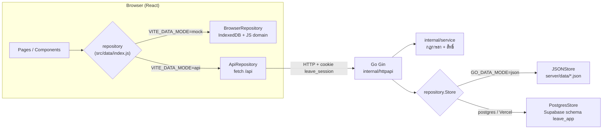
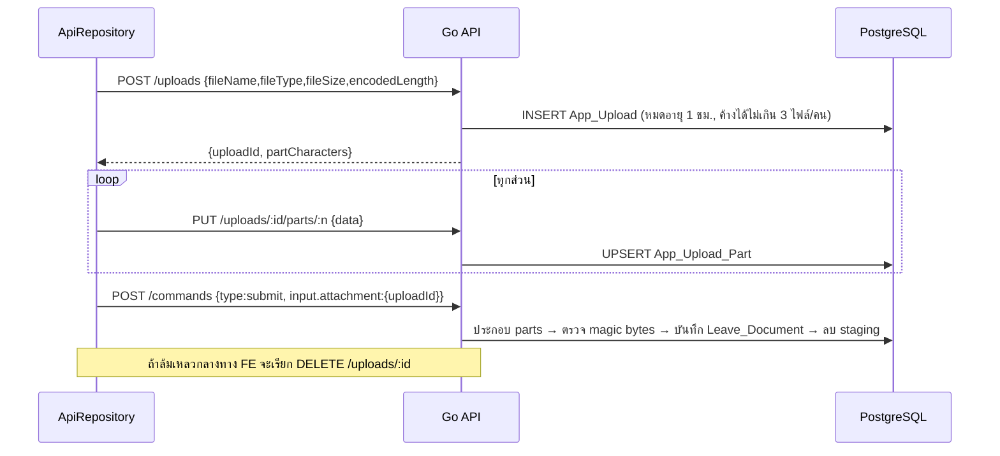
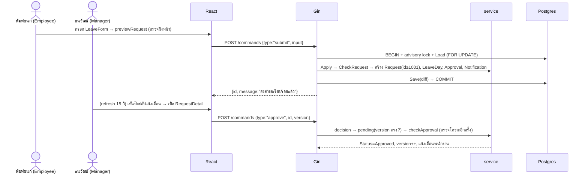

# สคริปต์อธิบายโค้ด — Leave Management (ProjectSABIS_LeaveAPP)

> [!NOTE]
> เนื้อหาทั้งหมดอ่านจาก **source code จริง** เป็นหลัก (Go, JS/JSX, SQL, config) ไม่ได้สรุปจาก .md
> แต่ละช่วงมี **🎤 พูด** = บทพูด และ **🖥️ เปิดโชว์** = ไฟล์ที่ควรเปิดบนจอ เวลารวมประมาณ 25–30 นาที

---

## ช่วงที่ 0 — เปิดเรื่อง (1 นาที)

🎤 **พูด:**
"โปรเจกต์นี้คือระบบจัดการการลาภาษาไทยชื่อ Leave Management ผู้ใช้มี 3 บทบาทคือ Employee, Manager และ HR
พนักงานยื่นคำขอลา ผู้จัดการอนุมัติหรือไม่อนุมัติ และส่งไปขอความเห็น HR ได้ ส่วน HR ดูแลสิทธิ์วันลา วันหยุด นโยบาย และกรณีลาคลอด

แบ่งเป็น 4 ส่วน
1. **Frontend**: React + Vite + React Router + Tailwind
2. **API**: REST/JSON ใต้ `/api/*`
3. **Backend**: Go + Gin แบ่งชั้น httpapi → service → repository
4. **Database**: PostgreSQL บน Supabase สำหรับ cloud และไฟล์ JSON สำหรับรันในเครื่อง"

---

## ช่วงที่ 1 — สถาปัตยกรรมภาพรวม (3 นาที)

🎤 **พูด:**
"ส่วนสำคัญที่สุดคือ **Repository pattern** ทั้งฝั่งหน้าและฝั่งหลัง

- **ฝั่งหน้า**: [index.js](file:///f:/leave-management/src/data/index.js) อ่าน `VITE_DATA_MODE` แล้วเลือก implementation ถ้าเป็น `mock` ใช้ `BrowserRepository` ที่เก็บข้อมูลใน IndexedDB และรันกฎในเบราว์เซอร์ ไม่ต้องมีเซิร์ฟเวอร์ ถ้าเป็น `api` ใช้ `ApiRepository` ที่ยิง HTTP ไปหา Go สองตัวนี้ทำตามสัญญาเดียวกันคือ `LeaveRepository` ใน [types.js](file:///f:/leave-management/src/domain/types.js#L208-L219) หน้าจอจึงไม่รู้ว่าข้อมูลมาจากไหน
- **ฝั่งหลัง**: interface `Store`/`Tx` ใน [repository.go](file:///f:/leave-management/internal/repository/repository.go#L32-L51) มีสองตัวคือ `JSONStore` กับ `PostgresStore` ชั้น service ที่ถือกฎการลาจึงไม่ต้องรู้ว่าข้างหลังเป็น SQL หรือไฟล์"

🎤 **พูดต่อ (แนวคิดหลักของ backend):**
"backend นี้ใช้แนว **Load ทั้งก้อน → แก้ใน memory → Save เฉพาะส่วนต่าง**
ทุก request จะโหลดข้อมูลทั้งหมดเป็น struct `Database` ก้อนเดียว แล้ว service แก้ข้อมูลใน memory ตอนบันทึก repository จะเทียบ before/after แล้วเขียนเฉพาะแถวที่เปลี่ยน วิธีนี้เหมาะกับข้อมูลขนาดเดโม 10 คน และทำให้ Go กับ JS ใช้ logic ชุดเดียวกันได้ง่าย"

🖥️ **เปิดโชว์:** [model.go `Database`](file:///f:/leave-management/internal/model/model.go#L113-L126)

---

## ช่วงที่ 2 — Database (5 นาที)

### 2.1 ตาราง

🖥️ **เปิดโชว์:** [schema.sql](file:///f:/leave-management/database/schema.sql), [setup-10-people.sql](file:///f:/leave-management/database/supabase/setup-10-people.sql), [002-cloud-api.sql](file:///f:/leave-management/database/supabase/002-cloud-api.sql)

🎤 **พูด:**
"ฐานข้อมูลมี 14 ตาราง แบ่งเป็น 3 กลุ่ม"

| กลุ่ม | ตาราง | หน้าที่ |
|---|---|---|
| **9 ตารางหลัก (Data Dictionary)** | `Employee` | พนักงาน, role, `Manager_id` อ้างตัวเอง (self-reference), `Active` |
| | `Leave_Type` | นโยบายประเภทลา: `Quota_scope` (Annual/Pregnancy), `Day_count_basis`, `Advance_notice_days`, `Document_required_from_days`, `Eligible_gender` |
| | `Leave_Entitlement` | สิทธิ์ต่อคน/ประเภท/ปี (UNIQUE 3 คอลัมน์) |
| | `Maternity_Case` | กรณีลาคลอดที่ HR เปิด พร้อม `Maximum_days` |
| | `Leave_Request` | คำขอ + `Status`, `Duration` (Full/AM/PM), `Version`, `Timeline_json` |
| | `Leave_Day` | **แตกคำขอเป็นรายวัน** พร้อม `Units` 1 หรือ 0.5 และผูก `Entitlement_id` |
| | `Leave_Document` | เอกสารแนบ เก็บใน `Data_url` (TEXT base64) |
| | `Leave_Approval` | ขั้นพิจารณา: `Review_type` Decision (Manager) / Consultation (HR), `Cancelled` |
| | `Work_Status` | สถานะทำงานรายวัน In-office/WFH/Outside |
| **ตารางเสริมของแอป** | `App_Notification`, `App_Holiday` | การแจ้งเตือน, วันหยุดบริษัท |
| **ตารางสำหรับ Cloud API** | `App_Session`, `App_Upload`, `App_Upload_Part` | session (เก็บเฉพาะ hash), ไฟล์ที่กำลังอัปโหลดแบบแบ่งส่วน |

🎤 **พูด (จุดออกแบบที่ควรเน้น):**
- "**ไม่เก็บค่าที่คำนวณได้** เช่น Used_days, Remaining_days, Total_days แต่คำนวณจาก `Leave_Day` ผ่าน VIEW `Leave_Entitlement_Balance`, `Maternity_Case_Balance`, `Leave_Request_Summary` ([schema.sql L118-L130](file:///f:/leave-management/database/schema.sql#L118-L130)) โค้ด Go ก็คำนวณแบบเดียวกันในฟังก์ชัน `Balance`"
- "**วันที่** เก็บเป็น ISO ค.ศ. (`DATE`) และเวลาเป็น `TIMESTAMPTZ` UTC จะแปลงเป็น พ.ศ. เฉพาะตอนแสดงผล"
- "**Boolean** อย่าง `Active`, `Is_read`, `Cancelled` เก็บเป็น INTEGER 0/1 ตาม Data Dictionary"
- "**Version** ใช้ทำ optimistic concurrency ถ้ามีคนแก้คำขอก่อน อีกคนจะได้ 409 CONFLICT"
- "**CHECK constraints** กันข้อมูลผิดตั้งแต่ระดับฐาน เช่น `Units IN (0.5,1)`, `End_date >= Start_date`, เหตุผล 1–500 ตัวอักษร"

### 2.2 ความปลอดภัยบน Supabase

🎤 **พูด:**
"ตารางทั้งหมดอยู่ใน schema `leave_app` มีการ `ENABLE ROW LEVEL SECURITY` และ `REVOKE ALL ... FROM PUBLIC, anon, authenticated` ดังนั้น anon key ของ Supabase อ่านตารางตรงไม่ได้ ข้อมูลต้องผ่าน Go backend ที่ต่อ PostgreSQL โดยตรงเท่านั้น VIEW ก็ตั้ง `security_invoker = true`"

### 2.3 ข้อมูลตั้งต้น (seed) มีแหล่งเดียว

🎤 **พูด:**
"ข้อมูลเดโมอยู่ไฟล์เดียวคือ [leave-management-10-people.json](file:///f:/leave-management/src/data/leave-management-10-people.json) มีพนักงาน 10 คน ประเภทลา 4 แบบ (พักร้อน 10 วัน, ป่วย 30 วันโดยต้องมีใบรับรองแพทย์ตั้งแต่ 3 วัน, กิจ 6 วัน, คลอด 120 วันนับวันปฏิทิน) สิทธิ์ 60 แถว และคำขอ 14 รายการ
- React import ไฟล์นี้ใน [demoDatabase.js](file:///f:/leave-management/src/data/demoDatabase.js)
- Go ฝังไฟล์เดียวกันด้วย `//go:embed` ใน [seed.go](file:///f:/leave-management/src/data/seed.go)
- `npm run data:generate` สร้าง SQLite และ SQL ของ Supabase จาก JSON นี้

ทุกโหมดจึงใช้ข้อมูลชุดเดียวกัน"

---

## ช่วงที่ 3 — Backend Go (8 นาที)

### 3.1 จุดเริ่มโปรแกรม

🖥️ **เปิดโชว์:** [main.go](file:///f:/leave-management/cmd/server/main.go), [app.go](file:///f:/leave-management/internal/app/app.go)

🎤 **พูด:**
"รันในเครื่องเริ่มที่ `cmd/server/main.go` ซึ่งโหลด `.env` เรียก `app.New()` แล้วเปิด HTTP server ที่พอร์ต 3001 พร้อม timeout และ graceful shutdown

`app.go` เป็นจุดประกอบระบบ โดยอ่าน `GO_DATA_MODE`
- `json` (ค่าเริ่มต้น local) → `repository.NewJSON("server/data/leave-management-go.json")`
- `postgres` → `repository.OpenPostgres(POSTGRES_URL)`
- ถ้ารันบน Vercel (`VERCEL=1`) จะ**บังคับ postgres เสมอ** เพื่อกันการตั้งค่าผิดแล้วไปใช้ JSON บน production ([app.go L18-L28](file:///f:/leave-management/internal/app/app.go#L18-L28))
- demo login เปิดอัตโนมัติเฉพาะโหมด json ในเครื่อง ส่วน cloud ต้องตั้ง `ENABLE_DEMO_LOGIN=true` เอง"

### 3.2 ชั้น HTTP — `internal/httpapi`

🖥️ **เปิดโชว์:** [api.go L38-L73](file:///f:/leave-management/internal/httpapi/api.go#L38-L73)

🎤 **พูด:**
"ชั้นนี้แปลง HTTP เป็นการเรียก service โดยไม่มีกฎการลาอยู่ในชั้นนี้
- route สาธารณะมี `/health`, `POST /session` (login) และ `DELETE /session` (logout)
- route อื่นอยู่ใน group `private` ที่ผ่าน middleware `requireSession`
- มี adapter สำหรับ Vercel: Vercel rewrite `/api/xxx` → `/api/go?endpoint=xxx` แล้ว handler นี้ประกอบ path กลับเป็น `/api/xxx` ก่อนส่งให้ Gin ทำให้ frontend ไม่ต้องรู้เรื่องนี้"

**Middleware `protect`** ([L83-L112](file:///f:/leave-management/internal/httpapi/api.go#L83-L112))
🎤 "ทุก response ใส่ `Cache-Control: no-store` และ `nosniff` แล้วตรวจ `Origin` ว่าเป็น same-origin หรืออยู่ใน allowlist `GO_ALLOWED_ORIGINS` ถ้าเป็นคำขอข้ามเว็บ (`Sec-Fetch-Site: cross-site`) ที่ไม่ใช่ GET จะตอบ 403 ซึ่งช่วยกัน CSRF"

**Session** ([L113-L158](file:///f:/leave-management/internal/httpapi/api.go#L113-L158))
🎤 "ตอน login จะสุ่ม token 32 ไบต์ (hex 64 ตัว) ส่งเป็น cookie `leave_session` ที่ตั้ง `HttpOnly`, `SameSite=Lax`, `Path=/api` และหมดอายุใน 8 ชั่วโมง **ฐานข้อมูลเก็บแค่ SHA-256 ของ token** ถ้าฐานรั่ว คนที่ได้ไปก็ใช้ hash เข้าระบบไม่ได้ ทุก request ที่ต้องล็อกอินจะเรียก `authenticate` ใน transaction เพื่อตรวจว่า session ยังไม่หมดอายุ **และพนักงานยัง active** อยู่"

**`run()` — รูปแบบที่ทุก endpoint ใช้** ([L216-L231](file:///f:/leave-management/internal/httpapi/api.go#L216-L231))
🎤 "ทุก endpoint ทำงานในรูปแบบเดียวกัน: เปิด transaction → authenticate → เรียก service → ถ้ามี error ก็ rollback → ถ้าสำเร็จก็ commit และส่ง JSON"

**การแปลง error** ([L198-L215](file:///f:/leave-management/internal/httpapi/api.go#L198-L215))
🎤 "service คืน `service.Error{Message, Code}` แล้ว `fail()` แปลง code เป็น HTTP status เช่น UNAUTHENTICATED→401, FORBIDDEN→403, NOT_FOUND→404, CONFLICT→409, PAYLOAD_TOO_LARGE→413, VALIDATION→400 ถ้าเป็น error ที่ไม่รู้จัก ผู้ใช้จะเห็นข้อความกลาง ๆ ส่วน log จะบันทึกแค่ชนิด error, SQLSTATE และ route **ไม่บันทึก SQL หรือค่าพารามิเตอร์**"

**`command()` — endpoint เดียวสำหรับทุกการเขียน** ([L337-L380](file:///f:/leave-management/internal/httpapi/api.go#L337-L380))
🎤 "ทุกการเขียนข้อมูลผ่าน `POST /api/commands` โดยใช้ field `type` แยกคำสั่ง ขั้นตอนคือ Load → `model.Clone(db)` เก็บ before → `service.Apply()` แก้ข้อมูล → `tx.Save(before, db)` ถ้ามีไฟล์แนบที่อัปโหลดไว้ จะประกอบไฟล์จาก staging ก่อน แล้วลบ staging หลัง save"

### 3.3 ชั้น Service — กฎธุรกิจทั้งหมด

🖥️ **เปิดโชว์:** [commands.go `Apply`](file:///f:/leave-management/internal/service/commands.go#L12-L68)

🎤 **พูด:**
"`Apply` เป็นตัว dispatch คำสั่งทั้งหมด"

| คำสั่ง | ใครทำได้ | ทำอะไร |
|---|---|---|
| `submit` / `edit` | Employee (เจ้าของ) | ตรวจด้วย `CheckRequest` แล้วสร้าง LeaveDay, Approval (Manager/Decision) และแจ้งเตือน ถ้าเป็น edit จะยกเลิก approval เดิมแล้วเริ่มพิจารณาใหม่ |
| `withdraw` | Employee (เจ้าของ) | ตั้ง status เป็น Withdrawn ยกเลิก approval และแจ้งผู้จัดการ |
| `approve` / `reject` | Manager ที่เป็นหัวหน้าตรง | reject ต้องมีความเห็น ส่วน approve จะ**ตรวจโควตาอีกครั้ง** (`checkApproval`) |
| `refer` | Manager | สร้าง approval แบบ Consultation ส่งให้ HR |
| `consult` | HR ที่ได้รับมอบหมาย | ส่งความเห็นกลับ แต่ผลสุดท้ายยังเป็นของ Manager |
| `work` | ทุกคน | บันทึก In-office/WFH/Outside (ห้ามบันทึกวันที่ลาเต็มวันที่อนุมัติแล้ว) |
| `readNotifications` | ทุกคน | ทำเครื่องหมายอ่านแล้ว |
| `entitlement`, `maternity`, `holiday`, `policy` | HR เท่านั้น ([admin.go](file:///f:/leave-management/internal/service/admin.go)) | จัดการสิทธิ์ เปิดกรณีลาคลอด วันหยุด นโยบาย |

🖥️ **เปิดโชว์:** [requests.go `CheckRequest`](file:///f:/leave-management/internal/service/requests.go#L92-L221)

🎤 **พูด — ลำดับการตรวจคำขอลา (ส่วนที่ซับซ้อนที่สุด):**
1. ต้องเป็น Employee ถ้าเป็นการแก้ไข คำขอต้องเป็นของตัวเองและยัง Pending
2. ถ้าเป็นลาคลอด เพศต้องเป็น Female (อ่านจากฐาน ไม่เชื่อค่าที่ส่งมาใน body) และต้องเลือก Maternity Case ของตัวเอง
3. ต้องมีผู้จัดการ และต้องระบุเหตุผล 1–500 ตัวอักษร
4. `inputDays` แตกช่วงวันที่เป็นรายวัน: ถ้านับ Working Days จะ**ข้ามเสาร์ อาทิตย์ และวันหยุดใน App_Holiday** ลาครึ่งวันได้ 0.5 และต้องเป็นวันเดียว ลาคลอดต้องเต็มวันและนับวันปฏิทิน ช่วงยาวสุด 366 วัน
5. ต้องยื่นล่วงหน้าตาม `AdvanceNoticeDays` ถ้าเป็น 0 (ลาป่วย) ยื่นย้อนหลังได้ไม่เกิน 30 วัน โดยนับ "วันนี้" ตามเวลา Asia/Bangkok
6. ถ้าจำนวนวันถึง `DocumentRequiredFromDays` ต้องแนบเอกสาร (ลาป่วยตั้งแต่ 3 วันต้องมีใบรับรองแพทย์)
7. **ตรวจวันซ้อน** กับคำขอที่ Pending/Approved ยกเว้นครึ่งวันเช้ากับครึ่งวันบ่ายในวันเดียวกัน
8. **ตรวจโควตาแยกตามปี** ถ้าคำขอคร่อมปี จะตรวจแต่ละปีแยกกัน โดยคิด `Remaining - Pending` เพื่อกันการยื่นเกินสิทธิ์"

🖥️ **เปิดโชว์:** [scope.go `Snapshot` + `Balance`](file:///f:/leave-management/internal/service/scope.go#L75-L146)

🎤 **พูด — การจำกัดข้อมูลตามสิทธิ์:**
"`GET /snapshot` ไม่ได้ส่งข้อมูลทั้งฐาน แต่กรองตาม role
- **Employee** เห็นคำขอของตัวเอง ข้อมูลผู้จัดการตัวเอง และรายชื่อ HR
- **Manager** เห็นข้อมูลของลูกทีมที่ `managerId` เป็นตัวเอง
- **HR** เห็นข้อมูลทุกคน
- การแจ้งเตือนเห็นเฉพาะของตัวเอง
- เอกสารแนบส่งแค่ metadata (`dataUrl = ""`, `remote = true`) ไม่ส่งเนื้อไฟล์ใน snapshot

`Balance` คำนวณ Used จาก LeaveDay ของคำขอที่ Approved, Pending จากคำขอที่ Pending และ Total จาก Entitlement หรือ MaternityCase"

🎤 **พูด — ไฟล์ service อื่น ๆ:**
- [auth.go](file:///f:/leave-management/internal/service/auth.go): รหัสเดโม `1234` และ mapping จากอีเมลเป็นชื่อผู้ใช้ เช่น `pimchanok`, `thanawat`, `siriporn` ถ้าชื่อผู้ใช้ตรงกับหลายบัญชีจะปฏิเสธ
- [attachments.go](file:///f:/leave-management/internal/service/attachments.go): รับเฉพาะ PDF/PNG/JPEG ไม่เกิน 25 MB และ**ตรวจ magic bytes** (`%PDF-`, `\x89PNG`, `\xff\xd8\xff`) เพื่อกันการเปลี่ยนนามสกุลไฟล์ปลอม
- [colleagues.go](file:///f:/leave-management/internal/service/colleagues.go): ค้นหาเพื่อนร่วมงานด้วยชื่อหรือรหัส `EMP-00001` เรียงชื่อด้วย Thai collation และคำนวณสถานะลาจากคำขอที่อนุมัติแล้ว
- [employee_profile.go](file:///f:/leave-management/internal/service/employee_profile.go): Employee ดูได้แค่โปรไฟล์ตัวเอง Manager/HR ดูข้ามฝ่ายได้ บัญชี inactive ดูได้เฉพาะ HR
- [date.go](file:///f:/leave-management/internal/service/date.go): `TextLength` นับตัวอักษรแบบ UTF-16 ให้ตรงกับ JavaScript (emoji นับเป็น 2)

### 3.4 ชั้น Repository

🖥️ **เปิดโชว์:** [postgres.go](file:///f:/leave-management/internal/repository/postgres.go)

🎤 **พูด:**
- "**การเชื่อมต่อ** ([L25-L72](file:///f:/leave-management/internal/repository/postgres.go#L25-L72)): ใช้ pgx pool ขนาด 2 connection และใช้ **Simple Protocol โดยปิด statement cache** เพราะ Supabase Transaction Pooler เก็บ prepared statement ข้าม transaction ไม่ได้ ถ้าไม่ปิดจะเจอ error SQLSTATE 26000 นอกจากนี้บังคับ TLS 1.2+ เสมอ ยกเว้น localhost ที่ต้องเปิดเองด้วย `POSTGRES_LOCAL`"
- "**Transaction** ([L75-L94](file:///f:/leave-management/internal/repository/postgres.go#L75-L94)): ฝั่งอ่านใช้ `RepeatableRead + ReadOnly` ส่วนฝั่งเขียนเรียก `pg_advisory_xact_lock(1279607126,1)` ทำให้**การเขียนทั้งระบบทำทีละรายการ** จึงไม่มีปัญหาผู้จัดการสองคนกดอนุมัติพร้อมกันแล้วโควตาติดลบ"
- "**Load** ([L134-L173](file:///f:/leave-management/internal/repository/postgres.go#L134-L173)): ตาราง `tables` map ชื่อคอลัมน์ SQL กับ key JSON แต่ละตารางใช้ `json_agg(row_to_json(...))` query เดียว และแปลง 0/1 เป็น boolean, DATE เป็น text, TIMESTAMPTZ เป็น ISO UTC ส่วน `data_url` ไม่โหลดมาเพราะใหญ่"
- "**Save** ([L197-L263](file:///f:/leave-management/internal/repository/postgres.go#L197-L263)): เทียบ before/after แล้ว **DELETE แถวที่หายไป โดยลบตารางลูกก่อนตารางแม่** จากนั้น **UPSERT (`INSERT ... ON CONFLICT DO UPDATE`) เฉพาะแถวที่เปลี่ยน** มีสองจุดที่ต้องระวัง: insert พนักงานที่ไม่มี manager ก่อนเพราะ FK อ้างตัวเอง และ `data_url` ใช้ `CASE` เพื่อไม่ทับไฟล์เดิมด้วยค่าว่าง ค่าทั้งหมดส่งผ่าน `$1, $2…` ไม่ต่อ string"

🖥️ **เปิดโชว์:** [json.go](file:///f:/leave-management/internal/repository/json.go#L44-L98)

🎤 "`JSONStore` ใช้ `sync.Mutex` ล็อก ถ้าเป็นการเขียนจะ clone state ทำงานบนสำเนา แล้วบันทึกแบบ **atomic** คือเขียนไฟล์ temp แล้ว `os.Rename` ทับ ถ้า error กลางทาง state เดิมจะไม่เสีย จึงทำงานคล้าย rollback ส่วน session และ upload ของโหมดนี้เก็บใน memory"

---

## ช่วงที่ 4 — API Contract (4 นาที)

🎤 **พูด:** "endpoint ทั้งหมดอยู่ใน [api.go L46-L60](file:///f:/leave-management/internal/httpapi/api.go#L46-L60)"

| Method | Path | Auth | หน้าที่ |
|---|---|---|---|
| GET | `/api/health` | – | ตรวจสถานะ คืน `mode`, `backend: go-gin`, `documentTransport: parts-v1` |
| POST | `/api/session` | – | Login `{email, password}` → set cookie แล้วคืน `{employee}` |
| DELETE | `/api/session` | – | Logout ลบ session และล้าง cookie |
| GET | `/api/session` | ✅ | ดึงผู้ใช้ปัจจุบัน |
| GET | `/api/snapshot` | ✅ | ข้อมูลทั้งหมด**ที่กรองตามสิทธิ์แล้ว** |
| GET | `/api/colleagues?query=&date=` | ✅ | ค้นหาสถานะเพื่อนร่วมงาน |
| GET | `/api/employee-profile?employeeId=` | ✅ | โปรไฟล์ `{employee, manager{id,name}}` |
| POST | `/api/commands` | ✅ | **ทุกการเขียน** `{type, ...}` |
| POST | `/api/demo/reset` | ✅ HR | คืนค่าข้อมูลเดโม |
| POST | `/api/uploads` | ✅ Employee | เริ่มอัปโหลด → `{uploadId, partCharacters}` |
| PUT | `/api/uploads/:id/parts/:part` | ✅ | ส่ง base64 ทีละส่วน (2 MiB ตัวอักษร) |
| DELETE | `/api/uploads/:id` | ✅ | ยกเลิกอัปโหลด |
| GET | `/api/documents/:id` และ `/parts/:part` | ✅ | ดาวน์โหลดเอกสารทีละส่วน (ตรวจ `CanView`) |

🎤 **พูด — ทำไมต้องอัปโหลดแบบแบ่งส่วน:**
"Vercel จำกัดขนาด body ของ function แต่ไฟล์แนบใหญ่ได้ถึง 25 MB ซึ่งเป็น base64 ประมาณ 33 ล้านตัวอักษร จึงแบ่งเป็นส่วนละ 2 MiB ตัวอักษร โดยจำกัด body ไว้ที่ 3 MB ([attachments.go L10-L12](file:///f:/leave-management/internal/service/attachments.go#L10-L12))"

🖥️ **เปิดโชว์:** [apiRepository.js `execute`](file:///f:/leave-management/src/data/apiRepository.js#L90-L136), [documents.go `resolveAttachment`](file:///f:/leave-management/internal/httpapi/documents.go#L44-L77)

🎤 "ฝั่งดาวน์โหลดทำแบบเดียวกัน คือขอ metadata ก่อน แล้วดึงทีละส่วนด้วย SQL `substring(data_url ...)` และ frontend ตรวจขนาดไฟล์ที่ได้ให้ตรงกับ `fileSize`"

---

## ช่วงที่ 5 — Frontend React (6 นาที)

### 5.1 โครงสร้างและ Routing

🖥️ **เปิดโชว์:** [main.jsx](file:///f:/leave-management/src/main.jsx), [App.jsx](file:///f:/leave-management/src/App.jsx), [routes.jsx](file:///f:/leave-management/src/routes.jsx)

🎤 **พูด:**
"`main.jsx` render `<App/>` ซึ่งใช้ **HashRouter** URL จึงเป็นแบบ `#/dashboard`, `#/request/1001` ข้อดีคือ deploy เป็น static ได้โดยไม่ต้องตั้ง rewrite ฝั่ง server

`createWorkspaceRoutes` สร้าง route ตาม role
- ทุกคน: `/dashboard`, `/requests`, `/request/:id`, `/work`, `/colleagues`, `/employee/:id`, `/notifications`
- Employee เพิ่ม: `/new`, `/quota`, `/request/:id/edit`
- Manager/HR เพิ่ม: `/calendar`
- HR เพิ่ม: `/admin`, `/settings`

ในโค้ดมีคอมเมนต์ว่า *'Page access is a presentation rule'* หมายความว่าการซ่อน route เป็นแค่เรื่อง UX **สิทธิ์จริงตรวจที่ backend** ถ้าเปิด URL ตรง API ก็ยังตอบ 403"

### 5.2 State หลักใน `Workspace`

🎤 **พูด:**
"`Workspace` ใน App.jsx เก็บ state หลักคือ `actor` (ผู้ใช้ที่ล็อกอิน) และ `db` (snapshot) แล้วส่ง `{actor, db, run, reload}` ลงไปทุกหน้า
- **`run(command)`** ([L218-L228](file:///f:/leave-management/src/App.jsx#L218-L228)) เรียก `repository.execute` แล้ว `reload()` และแสดง toast ถ้าได้ CONFLICT (version ไม่ตรง) จะ reload ข้อมูลล่าสุดให้อัตโนมัติ
- **การ refresh ข้อมูล** ([L182-L207](file:///f:/leave-management/src/App.jsx#L182-L207)) เกิดเมื่อกลับมาโฟกัสหน้าต่าง, เมื่อได้ข้อความจาก BroadcastChannel ข้ามแท็บ และทุก 15 วินาทีในโหมด api ถ้าได้ 401 จะกลับไปหน้า Login
- **`sessionVersion`** ใช้กันกรณี snapshot เก่าตอบกลับมาหลังผู้ใช้ logout หรือเปลี่ยนบัญชีไปแล้ว
- **login/logout** มี 3 จังหวะคือ checking → ready → leaving ([motion.js](file:///f:/leave-management/src/motion.js): 650/320/240 ms) โดยต้องโหลด snapshot สำเร็จก่อนจึงเปิด workspace ใช้ `AbortController` กันกดซ้ำ และข้ามแอนิเมชันถ้าเครื่องตั้ง Reduce Motion"

### 5.3 หน้าจอหลัก

| ไฟล์ | หน้าที่ |
|---|---|
| [Login.jsx](file:///f:/leave-management/src/Login.jsx) | เลือกบทบาทก่อน แล้ว dropdown จะแสดงเฉพาะบัญชีของบทบาทนั้น เลือกบัญชีแล้วรหัส `1234` เติมให้ ถ้าพิมพ์ชื่อเองจะไม่เติม (บทบาทที่เลือกเป็นแค่ตัวช่วยกรอก สิทธิ์จริงมาจาก backend) |
| [Dashboard.jsx](file:///f:/leave-management/src/Dashboard.jsx) | สรุปตาม role: Employee เห็นวันลาคงเหลือ, Manager เห็นคำขอของทีม, HR เห็นคำขอปรึกษา |
| [LeaveForm.jsx](file:///f:/leave-management/src/pages/LeaveForm.jsx) | ฟอร์ม 3 ขั้น (กรอก → ตรวจสอบ → สำเร็จ) ใช้ `previewRequest` จาก JS domain ตรวจก่อนส่ง แปลงวันที่ พ.ศ. `5/12/2569` เป็น ISO และอ่านไฟล์เป็น data URL |
| [RequestDetail.jsx](file:///f:/leave-management/src/pages/RequestDetail.jsx) | ปุ่มดำเนินการตามบทบาท: เจ้าของ = แก้ไข/ยกเลิก, Manager = อนุมัติ/ไม่อนุมัติ/ส่งปรึกษา HR (ปุ่มถูก disable ระหว่างรอ HR), HR ที่ได้รับมอบหมาย = ส่งความเห็น ทุกคำสั่งส่ง `version` ไปด้วย |
| [Requests.jsx](file:///f:/leave-management/src/pages/Requests.jsx), [Quotas.jsx](file:///f:/leave-management/src/pages/Quotas.jsx), [CalendarPage.jsx](file:///f:/leave-management/src/pages/CalendarPage.jsx) | รายการคำขอ, โควตา, ปฏิทินการลา |
| [WorkPage.jsx](file:///f:/leave-management/src/pages/WorkPage.jsx), [ColleaguesPage.jsx](file:///f:/leave-management/src/ColleaguesPage.jsx) | บันทึกสถานะทำงาน, ค้นหาเพื่อนร่วมงาน (เรียก `searchColleagues`) |
| [AdminPage.jsx](file:///f:/leave-management/src/pages/AdminPage.jsx), [SettingsPage.jsx](file:///f:/leave-management/src/pages/SettingsPage.jsx) | HR: สิทธิ์วันลา, กรณีลาคลอด, วันหยุด, นโยบาย, export JSON, reset เดโม |
| [EmployeeProfilePage.jsx](file:///f:/leave-management/src/pages/EmployeeProfilePage.jsx) | ใช้ได้ทั้งแบบเต็มหน้าและป๊อปอัป (ผ่าน `EmployeeProfileContext`) |
| [NotificationToasts.jsx](file:///f:/leave-management/src/NotificationToasts.jsx) | ป๊อปอัปมุมขวาล่าง 3 วินาที ใช้ snapshot แรกเป็น baseline เพื่อไม่ให้แจ้งเตือนเก่าเด้งตอน login กันซ้ำด้วย `id:createdAt` และหยุดนับเวลาเมื่อ hover/focus |
| [ui.jsx](file:///f:/leave-management/src/ui.jsx) | `CommandMenu` (Ctrl/⌘+K), QuotaRing, WelcomeHero ฯลฯ |
| [labels.js](file:///f:/leave-management/src/labels.js) | แปลง enum เป็นข้อความไทย**ตอนแสดงผลเท่านั้น** ค่าที่เก็บในฐานยังเป็นภาษาอังกฤษ |

🎤 **พูด — custom hook:**
"[useTask.js](file:///f:/leave-management/src/pages/useTask.js) รวม `busy` / `error` / `perform` ไว้ที่เดียว ทุกหน้าที่ส่งคำสั่งจึงจัดการสถานะ loading และ error แบบเดียวกัน"

### 5.4 โหมด mock — JS domain ในเบราว์เซอร์

🖥️ **เปิดโชว์:** [browserRepository.js](file:///f:/leave-management/src/data/browserRepository.js), [service.js](file:///f:/leave-management/src/domain/service.js)

🎤 **พูด:**
"โหมด mock ไม่มี backend `BrowserRepository` จึงเรียก `applyCommand` / `visibleSnapshot` จาก [src/domain/service.js](file:///f:/leave-management/src/domain/service.js) ซึ่ง**เขียนกฎชุดเดียวกับ Go** แล้วเก็บผลใน IndexedDB
- ใช้ IndexedDB `readwrite` transaction เดียว เพื่อกันการอนุมัติซ้ำเมื่อเปิดหลายแท็บ
- ไฟล์ใหญ่แบ่งเก็บเป็น chunk ละ 4M ตัวอักษร เพราะ Chromium จำกัดขนาด record
- session เก็บใน `sessionStorage`
- เมื่อแก้ข้อมูลจะแจ้งแท็บอื่นผ่าน `BroadcastChannel`

เมื่อกฎมีสองชุด (Go กับ JS) จึงต้องมี `npm run test:parity` ([test-go-parity.js](file:///f:/leave-management/scripts/test-go-parity.js)) ส่ง input ชุดเดียวกันให้ทั้งสองฝั่งแล้วเทียบผลว่าตรงกัน"

---

## ช่วงที่ 6 — ตัวอย่าง flow ครบวงจร (2 นาที)

🎤 **พูด:** "ตัวอย่าง: พิมพ์ชนกยื่นลาพักร้อน แล้วธนวัฒน์อนุมัติ"

🎤 "เลขคำขอที่แสดงคือ `LR-2026-01001` สร้างจาก `RequestCode` (ปีที่ยื่นต่อด้วย id 5 หลัก) ถ้าระหว่างนั้นมีคนแก้คำขอ version จะไม่ตรง ระบบตอบ 409 แล้ว frontend reload ให้"

---

## ช่วงที่ 7 — Deploy, เครื่องมือ และการทดสอบ (2 นาที)

🖥️ **เปิดโชว์:** [package.json](file:///f:/leave-management/package.json), [vercel.json](file:///f:/leave-management/vercel.json), [vite.config.js](file:///f:/leave-management/vite.config.js)

🎤 **พูด:**
- "**รันในเครื่อง**: `npm run dev` = เดโมใน browser (mock), `npm run dev:api` = build Go แล้วรันคู่กับ Vite ผ่าน [dev-api.mjs](file:///f:/leave-management/scripts/dev-api.mjs) โดย Vite proxy `/api` ไปที่ `127.0.0.1:3001`, `npm run dev:cloud` = ใช้ Postgres จริง"
- "**Vercel**: frontend build ด้วย Vite ส่วน backend คือ function [api/go.go](file:///f:/leave-management/api/go.go) → [serverless/handler.go](file:///f:/leave-management/serverless/handler.go) ซึ่งสร้าง app ครั้งเดียวด้วย `sync.Once` ถ้าเริ่มไม่ได้จะตอบ 503 ที่ต้องมี package `serverless` คั่นกลาง เพราะ @vercel/go ห่อโค้ดเป็น module ใหม่ จึง import `internal/` ตรงไม่ได้ region ตั้งเป็น `sin1` (สิงคโปร์) และบน Vercel จะบังคับ `VITE_DATA_MODE=api`"
- "**Legacy**: โฟลเดอร์ `server/*.js` เป็น backend Node เดิม (`npm run dev:legacy`) ที่เก็บไว้เทียบผลระหว่างย้ายมา Go"
- "**การทดสอบ**: Node test runner ประมาณ 30 ไฟล์ใน `tests/`, Jest + React Testing Library ใน `tests/ui/`, Go test ใน `internal/**/_test.go`, `test:parity` เทียบ JS กับ Go, `test:go:postgres` จำลองการทิ้ง prepared statement ของ pooler และ `test:go:vercel` จำลองการ build ของ Vercel"

---

## ช่วงที่ 8 — ปิดท้าย (1 นาที)

🎤 **พูด:**
"สรุปจุดเด่นของสถาปัตยกรรม
1. **Repository pattern ทั้งสองฝั่ง** ทำให้สลับ mock/api/json/postgres ได้โดยไม่แก้หน้าจอหรือกฎ
2. **กฎธุรกิจอยู่ใน service ชั้นเดียว** ส่วน HTTP และ SQL แยกออกไป
3. **ตรวจสิทธิ์ที่ backend ทุกครั้ง** ทั้ง session, active, role, ความเป็นเจ้าของ และกรอง snapshot
4. **ความถูกต้องของข้อมูล** ใช้ advisory lock, optimistic version, ตรวจโควตาซ้ำตอนอนุมัติ และ CHECK constraint
5. **ความปลอดภัย** เก็บ token แบบ hash, cookie HttpOnly, ตรวจ Origin, ตรวจ magic bytes, ใช้ parameterized SQL และ RLS + REVOKE"

---

## ภาคผนวก — สิ่งที่เจอในโค้ดแต่ .md อาจไม่ได้พูดถึง

> [!TIP]
> ใช้เป็นคำตอบเมื่อถูกถามเชิงลึก

- **เมนู "การแจ้งเตือน"** ยังอยู่ในอาร์เรย์ `menus` แต่ถูก `filter` ออกเฉพาะตอนส่งให้แถบซ้าย ([App.jsx L377](file:///f:/leave-management/src/App.jsx#L377)) ทำให้ยังค้นหาเจอใน CommandMenu (Ctrl+K) และ route `/notifications` ยังใช้ได้
- ใน schema `Work_Status.Status_type` มีค่า `'Leave'` และมีคอลัมน์ `Leave_id` แต่**แอปไม่ได้ใช้** คำสั่ง `work` รับเฉพาะ In-office/WFH/Outside ส่วนสถานะลาคำนวณจาก LeaveDay ที่อนุมัติแล้ว (ใน mapping ของ Go คอลัมน์ `leave_id` มี key ว่าง [postgres.go L118](file:///f:/leave-management/internal/repository/postgres.go#L118))
- **id คำขอใหม่เริ่มที่ 1001** (`max(1001, nextID)`) ส่วน id ตารางอื่นใช้ max+1 ไม่ได้ใช้ SERIAL ของฐาน (ทำได้เพราะมี advisory lock ทำให้เขียนทีละรายการ)
- **แก้นโยบาย (`policy`)** แก้ได้เฉพาะชื่อ จำนวนวันล่วงหน้า โควตาตั้งต้น และเกณฑ์เอกสาร ส่วน `quotaScope` / `dayCountBasis` / `eligibleGender` แก้ไม่ได้ และ Go ใช้ `UnmarshalJSON` แบบกำหนดเองเพื่อแยก "ไม่ส่ง field" ออกจาก "ส่งค่า 0" ([model.go L164-L186](file:///f:/leave-management/internal/model/model.go#L164-L186))
- **ตั้งสิทธิ์วันลา (`entitlement`)** ต้องเป็นทวีคูณของ 0.5 และต้องไม่น้อยกว่า used + pending
- **Upload staging** ค้างได้ไม่เกิน 3 ไฟล์ต่อคน หมดอายุใน 1 ชั่วโมง และ part number อยู่ในช่วง 0–67
- **Reset demo** (HR) ลบ upload ทั้งหมดและลบ session ของบัญชีที่ไม่อยู่ในชุดเดโม
- Gin ตั้ง `SetTrustedProxies(nil)` และถือว่าเป็น HTTPS จาก `X-Forwarded-Proto` เฉพาะโหมด cloud (`SecureProxy`) เพื่อตั้ง cookie `Secure`
